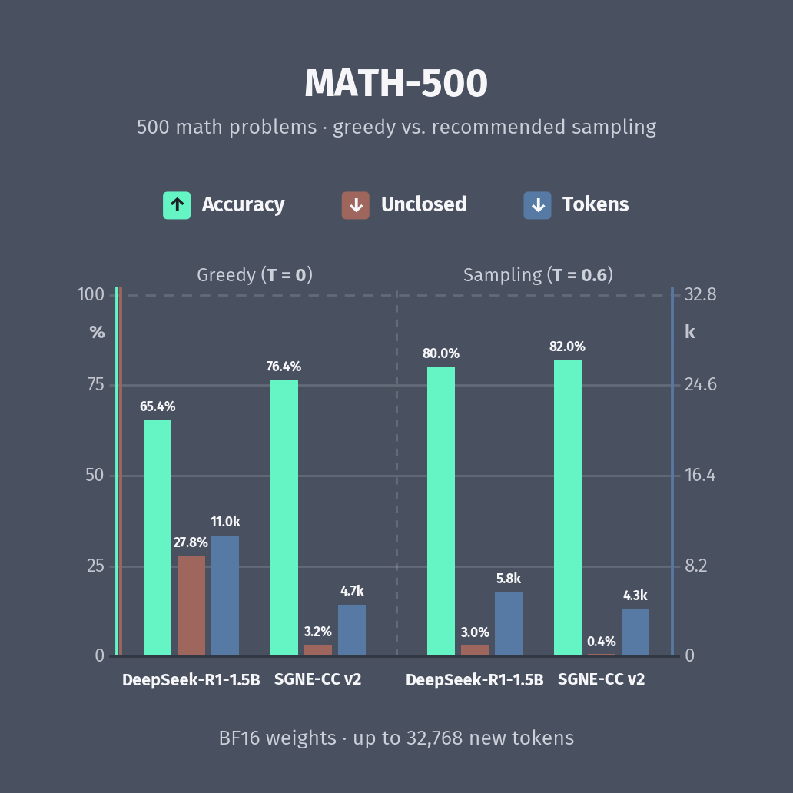
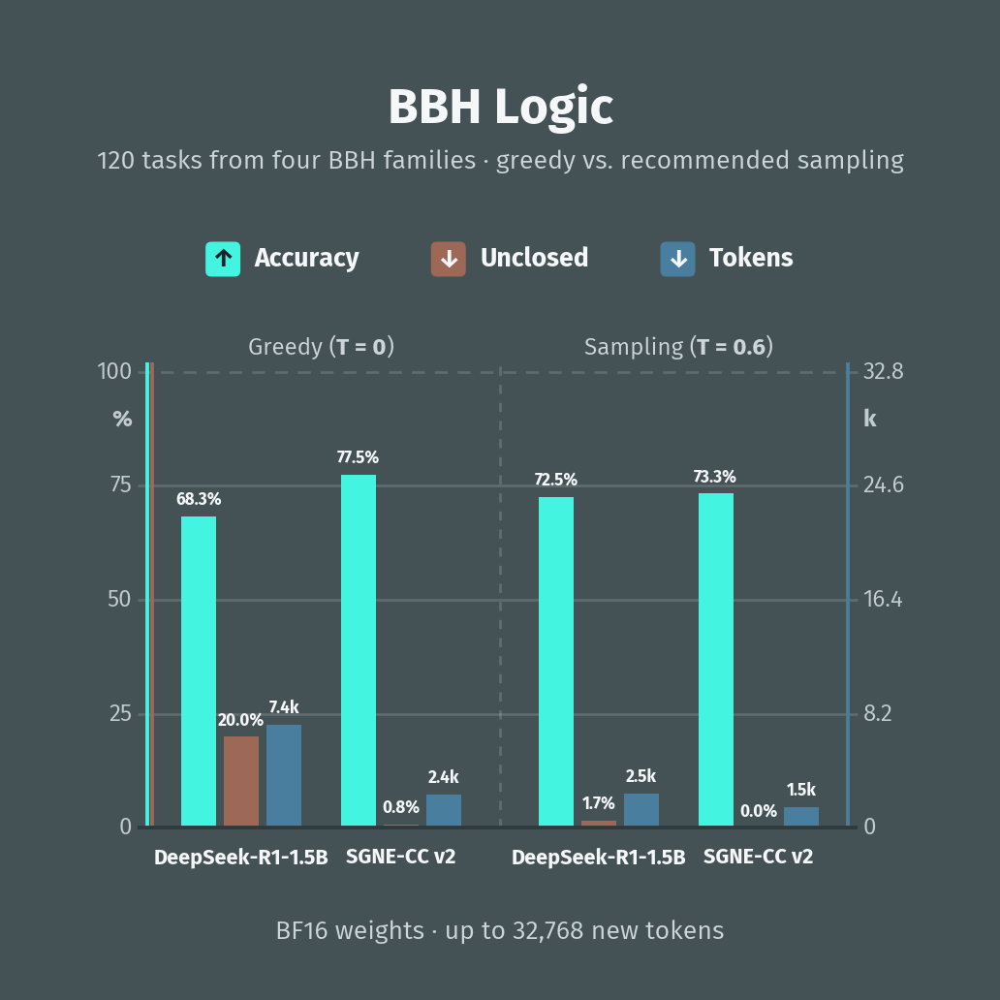

# SGNE-CC v2: Editing 205 Weight Columns in `DeepSeek-R1-Distill-Qwen-1.5B`

[](https://doi.org/10.5281/zenodo.24398165)

**[Русская версия (README_RU.md)](README_RU.md)** · **[Full Paper (EN)](article/ARTICLE_EN.md)** · **[Полная статья (RU)](article/ARTICLE_RU.md)** · **[Datasets & Licenses](DATASETS_AND_LICENSES.md)** · **Author:** Igor M. Zhuk ([ORCID 0009-0003-1670-8388](https://orcid.org/0009-0003-1670-8388))

> **Version relationship (`v1` vs. `v2`) & theoretical framework (`DOT`):**  
> - **`v1` (`Qwen3.5-0.8B`, hybrid `GatedDeltaNet + Attention`):** [`Nondual-Observer/Qwen3.5-0.8B-SGNE-CC`](https://huggingface.co/Nondual-Observer/Qwen3.5-0.8B-SGNE-CC) · [`Nondual-Observer/dna-weight-editing`](https://github.com/Nondual-Observer/dna-weight-editing) · [DOI: `10.5281/zenodo.24235218`](https://doi.org/10.5281/zenodo.24235218) (`1,984` edited columns plus `1` gate row, `0.270%` of weights).  
> - **`v2` (This repository — `DeepSeek-R1-Distill-Qwen-1.5B`, pure `SwiGLU` transformer):** **[`Nondual-Observer/DeepSeek-R1-Distill-Qwen-1.5B-SGNE-CC-v2`](https://huggingface.co/Nondual-Observer/DeepSeek-R1-Distill-Qwen-1.5B-SGNE-CC-v2)** · [DOI: `10.5281/zenodo.24398165`](https://doi.org/10.5281/zenodo.24398165) (Concept DOI [`10.5281/zenodo.24398164`](https://doi.org/10.5281/zenodo.24398164)) · **`205` `mlp.down_proj` columns (`0.0177%` of weights)**, zero attention/gate/normalization/code edits, evaluated with a generation budget of **`32,768` new tokens** on `1,054` problems (`5` benchmarks, `5,270` total generated traces).  
> - **Theoretical framework (`DOT`):** *Distinction Observable Theory (`DOT`)* ([`Nondual-Observer/DOTheory`](https://github.com/Nondual-Observer/DOTheory) · [Zenodo Concept DOI: `10.5281/zenodo.23481643`](https://doi.org/10.5281/zenodo.23481643)).

---

## Key Results (`BF16`, `32,768`-token budget, `presence_penalty = 0`)

| Benchmark (`N`) | Mode | Base Model: Acc (`C / W / No </think>`) · Tok | `SGNE-CC v2`: Acc (`C / W / No </think>`) · Tok | Gained / Lost ($p$) |
| :--- | :--- | :---: | :---: | :--- |
| **MATH-500** (`500`) | Greedy (`T = 0`) | `65.4%` (`327` / `34` / `139`) · `11.0k` | **`76.4%`** (`382` / `102` / **`16`**) · **`4.7k`** | **`+11.0 pp`** (`+74 / −19`, $p = 7.72 \times 10^{-9}$) |
| **MATH-500** (`500`) | Sampling (`T = 0.6`) | `80.0%` (`400` / `85` / `15`) · `5.8k` | **`82.0%`** (`410` / `88` / **`2`**) · **`4.3k`** | `+2.0 pp` (`+33 / −23`, $p = 0.2288$) |
| **MBPP** (`120`) | Greedy (`T = 0`) | `53.3%` (`64` / `11` / `45`) · `13.1k` | **`67.5%`** (`81` / `32` / **`7`**) · **`3.6k`** | **`+14.2 pp`** (`+21 / −4`, $p = 9.11 \times 10^{-4}$) |
| **MBPP** (`120`) | Sampling (`T = 0.6`) | `67.5%` (`81` / `35` / `4`) · `4.8k` | `64.2%` (`77` / `43` / **`0`**) · **`2.2k`** | `-3.3 pp` (`+7 / −11`, $p = 0.4807$) |
| **HumanEval** (`164`) | Greedy (`T = 0`) | `52.4%` (`86` / `15` / `63`) · `13.8k` | **`53.7%`** (`88` / `59` / **`17`**) · **`6.2k`** | `+1.2 pp` (`+20 / −18`, $p = 0.8714$) |
| **HumanEval** (`164`) | Sampling (`T = 0.6`) | `65.9%` (`108` / `49` / `7`) · `5.8k` | **`68.9%`** (`113` / `49` / **`2`**) · **`3.3k`** | `+3.0 pp` (`+16 / −11`, $p = 0.4421$) |
| **ARC-Challenge** (`150`) | Greedy (`T = 0`) | `52.7%` (`79` / `37` / `34`) · `7.7k` | **`59.3%`** (`89` / `61` / **`0`**) · **`0.8k`** | `+6.7 pp` (`+28 / −18`, $p = 0.1839$) |
| **ARC-Challenge** (`150`) | Sampling (`T = 0.6`) | `57.3%` (`86` / `63` / `1`) · `1.5k` | `56.7%` (`85` / `65` / **`0`**) · **`1.1k`** | `-0.7 pp` (`+18 / −19`, $p = 1.0000$) |
| **BBH Logic** (`120`) | Greedy (`T = 0`) | `68.3%` (`82` / `14` / `24`) · `7.4k` | **`77.5%`** (`93` / `26` / **`1`**) · **`2.4k`** | `+9.2 pp` (`+23 / −12`, $p = 0.0895$) |
| **BBH Logic** (`120`) | Sampling (`T = 0.6`) | `72.5%` (`87` / `31` / `2`) · `2.5k` | **`73.3%`** (`88` / `32` / **`0`**) · **`1.5k`** | `+0.8 pp` (`+18 / −17`, $p = 1.0000$) |
| **Pooled (`1,054`)** | **Greedy (`T = 0`)** | `60.5%` (`638` / `111` / `305`) · `10.8k` | **`69.5%`** (`733` / `280` / **`41`**) · **`4.0k`** | **`+9.0 pp`** (`+166 / −71`, **$p = 6.07 \times 10^{-10}$**) |
| **Pooled (`1,054`)** | **Sampling (`T = 0.6`)** | `72.3%` (`762` / `263` / `29`) · `4.7k` | **`73.3%`** (`773` / `277` / **`4`**) · **`3.1k`** | `+1.0 pp` (`+92 / −81`, $p = 0.4472$) |

- **`MATH-500` after excluding `26` column-selection problems (`474` items):** `310 → 363` (`+70 / −17`, $p = 8.35 \times 10^{-9}$) at `T = 0`, and $p = 0.1690$ at `T = 0.6`. After also excluding `53` items from early §1 head-atlas inspection (**`421` items**): `276 → 321` (`+60 / −15`, $p = 1.59 \times 10^{-7}$) at `T = 0`, and `337 → 346` (`+29 / −20`, $p = 0.253$) at `T = 0.6`.
- **Non-math benchmarks pooled (`554` problems at `T = 0`):** `311 → 351` ($p = 0.00108$).




---

## Reproducing the Edited Checkpoint & Verifying Integrity

### 1. Verify all `42` SHA-256 checksums, patch structure, and `5,270` records
Requires: `numpy`.
```bash
python3 verification/verify_repo_integrity.py
```

### 2. Apply `FINAL_SGNE_CC_V2_205_PATCH.npz` to `deepseek-ai/DeepSeek-R1-Distill-Qwen-1.5B`
Requires: `numpy`, `torch`, `safetensors`.
```bash
python3 patch/apply_sgne_cc_v2_205_to_safetensors.py \
  --base-dir /path/to/DeepSeek-R1-Distill-Qwen-1.5B \
  --patch    patch/FINAL_SGNE_CC_V2_205_PATCH.npz \
  --out-dir  /path/to/DeepSeek-R1-Distill-Qwen-1.5B-SGNE-CC-v2
```

- Base `model.safetensors` SHA-256: `58858233513d76b8703e72eed6ce16807b523328188e13329257fb9594462945`
- Patch `FINAL_SGNE_CC_V2_205_PATCH.npz` SHA-256: `6f435a63eb306047fe55353b7a911d32a17dd999efa65f082dd1d7c3779a0b2c`

---

## Independent Replications & Audits

- **Per-problem `shared-rows` recount (`Human-AI-Evolution` / `@HedonismJesse`):** independently joined and recounted all five `MATH-500` runs in [`traces/shared_rows/`](traces/shared_rows/) ([discussion #4](https://github.com/RikiyaT/lm_understand-logs/issues/4#issuecomment-7085628487)), confirming every published count (`75.2%` strict boxed / `76.4%` lenient at `T = 0`, `+70/-21` strict) and showing that `SGNE-CC v2` converts surviving mid-trace loops from terminal failures (`138/141` unclosed in Base at `T = 0`) into mostly recoverable loops (`37/52` closed at `T = 0`, `25/29` at `T = 0.3`).
- **Companion `SGNE-CC v1` (`Qwen3.5-0.8B`) independent replications:** evaluated on `llama.cpp` by Dave Uhlemann in *Knowing Is Not Committing v0.5*, Sections 3.13–3.14 ([DOI: 10.5281/zenodo.24420522](https://doi.org/10.5281/zenodo.24420522), [repo](https://github.com/NeoCortex0815/knowing-is-not-committing)), and on Hugging Face `transformers` with a 5-arm component ablation by `Human-AI-Evolution` ([`weight-space-notes`](https://github.com/Human-AI-Evolution/weight-space-notes), [discussion #4](https://github.com/RikiyaT/lm_understand-logs/issues/4#issuecomment-7062726129)), confirming that removing the single `L16` decay-gate row does not reduce accuracy (`147/300` vs. `143/300`).
- **Curated catalogs:** indexed in [`Boom5426/Awesome-Weight-Space-Programming`](https://github.com/Boom5426/Awesome-Weight-Space-Programming) and [`SajjadPSavoji/awesome-weight-space-programming`](https://github.com/SajjadPSavoji/awesome-weight-space-programming).

---

## Repository Structure

- `article/` — [`ARTICLE_EN.md`](article/ARTICLE_EN.md) and [`ARTICLE_RU.md`](article/ARTICLE_RU.md)
- `patch/` — [`FINAL_SGNE_CC_V2_205_PATCH.npz`](patch/FINAL_SGNE_CC_V2_205_PATCH.npz) (`205` `mlp.down_proj` columns) and [`apply_sgne_cc_v2_205_to_safetensors.py`](patch/apply_sgne_cc_v2_205_to_safetensors.py)
- `cards/` — `14` publication figure cards (`01..07`, EN & RU)
- `datasets/` — `4` non-math benchmark JSON datasets + [`math500_ids_manifest.json`](datasets/math500_ids_manifest.json) (`unique_id` + `prompt_sha256` without raw `MATH-500` texts; see [`DATASETS_AND_LICENSES.md`](DATASETS_AND_LICENSES.md))
- `traces/` — `20` raw `65_REAL32K_*.jsonl` non-math trace files + [`math500_per_item_results.json`](traces/math500_per_item_results.json) (`2,500` `MATH-500` per-item scores, token counts, and `text_sha256` digests without raw problem texts; `5,270` total records) + [`shared_rows/`](traces/shared_rows/) (`5` `MATH-500` runs in cross-lab `shared-rows` JSONL format)
- `verification/` — [`SHA256_MANIFEST.json`](verification/SHA256_MANIFEST.json), [`SHA256_AND_METRICS_CERTIFICATE.json`](verification/SHA256_AND_METRICS_CERTIFICATE.json), and [`verify_repo_integrity.py`](verification/verify_repo_integrity.py)
