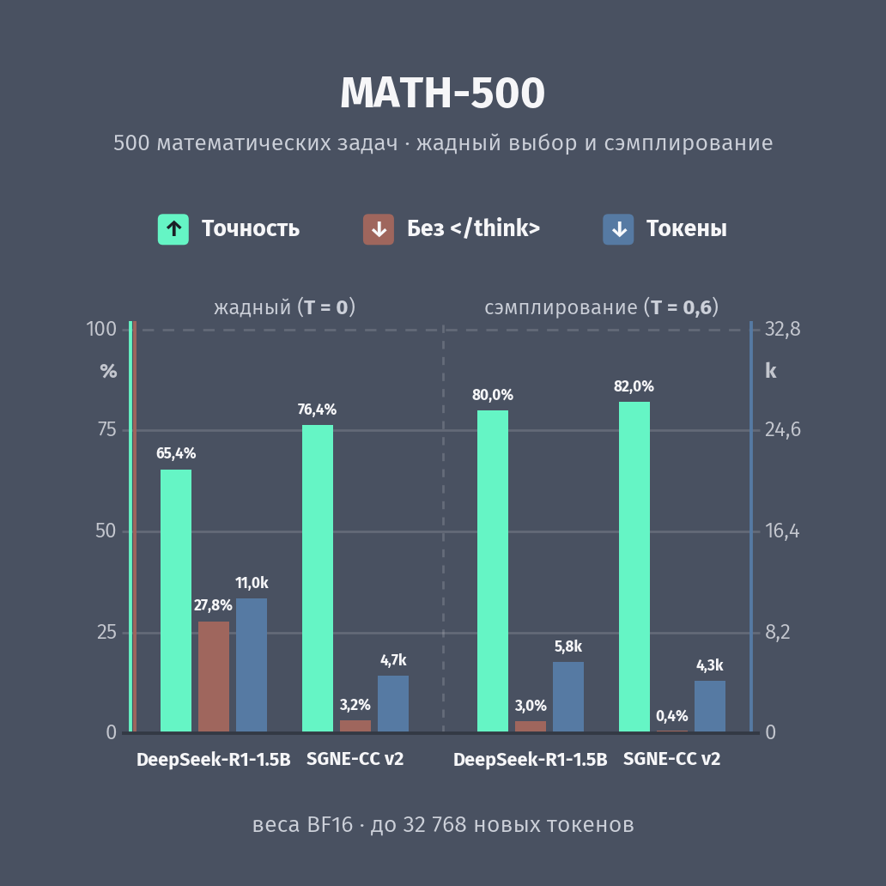
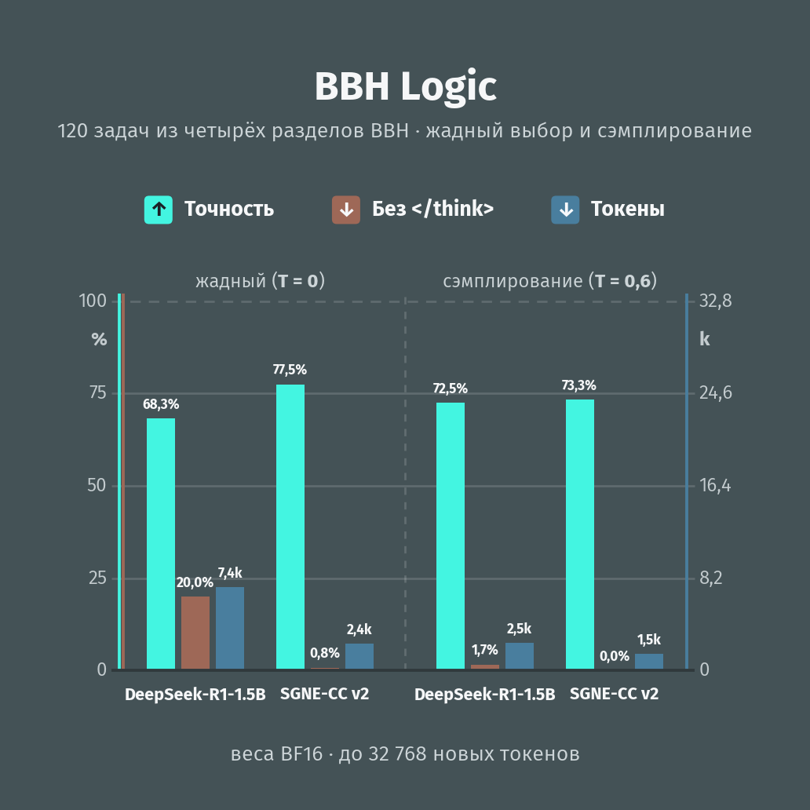

# SGNE-CC v2: Сферическая правка 205 столбцов весов `DeepSeek-R1-Distill-Qwen-1.5B`

[](https://doi.org/10.5281/zenodo.24398165)

**[English version (README.md)](README.md)** · **[Полная статья (RU)](article/ARTICLE_RU.md)** · **[Full Paper (EN)](article/ARTICLE_EN.md)** · **[Наборы данных и лицензии](DATASETS_AND_LICENSES.md)**

> **Связь версий (`v1` и `v2`):**  
> - **`v1` (`Qwen3.5-0.8B`, гибрид `GatedDeltaNet + Attention`):** [`Nondual-Observer/Qwen3.5-0.8B-SGNE-CC`](https://huggingface.co/Nondual-Observer/Qwen3.5-0.8B-SGNE-CC) · [`Nondual-Observer/dna-weight-editing`](https://github.com/Nondual-Observer/dna-weight-editing) · [DOI: `10.5281/zenodo.24235218`](https://doi.org/10.5281/zenodo.24235218) (`1 984` изменённых столбца и `1` строка ворот, `0.270%` весов).  
> - **`v2` (Данный репозиторий — `DeepSeek-R1-Distill-Qwen-1.5B`, чистый `SwiGLU`-трансформер):** **[`Nondual-Observer/DeepSeek-R1-Distill-Qwen-1.5B-SGNE-CC-v2`](https://huggingface.co/Nondual-Observer/DeepSeek-R1-Distill-Qwen-1.5B-SGNE-CC-v2)** · [DOI: `10.5281/zenodo.24398165`](https://doi.org/10.5281/zenodo.24398165) (Concept DOI [`10.5281/zenodo.24398164`](https://doi.org/10.5281/zenodo.24398164)) · **`205` столбцов `mlp.down_proj` (`0.0177%` весов)**, ноль изменений внимания, ворот, нормировок и кода инференса; проверка при бюджете **`32 768` новых токенов** на `1 054` задачах (`5` бенчмарков, `5 270` трасс).

---

## Основные результаты (`BF16`, бюджет `32 768` токенов, `presence_penalty = 0`)

| Набор (`N`) | Режим | Исходная модель: Точн. (`Верно / Ош. / Без </think>`) · Ток. | `SGNE-CC v2`: Точн. (`Верно / Ош. / Без </think>`) · Ток. | Приобретено / потеряно ($p$) |
| :--- | :--- | :---: | :---: | :--- |
| **MATH-500** (`500`) | Жадный (`T = 0`) | `65.4%` (`327` / `34` / `139`) · `11.0k` | **`76.4%`** (`382` / `102` / **`16`**) · **`4.7k`** | **`+11.0 п.п.`** (`+74 / −19`, $p = 7.72 \times 10^{-9}$) |
| **MATH-500** (`500`) | Сэмплирование (`T = 0.6`) | `80.0%` (`400` / `85` / `15`) · `5.8k` | **`82.0%`** (`410` / `88` / **`2`**) · **`4.3k`** | `+2.0 п.п.` (`+33 / −23`, $p = 0.2288$) |
| **MBPP** (`120`) | Жадный (`T = 0`) | `53.3%` (`64` / `11` / `45`) · `13.1k` | **`67.5%`** (`81` / `32` / **`7`**) · **`3.6k`** | **`+14.2 п.п.`** (`+21 / −4`, $p = 9.11 \times 10^{-4}$) |
| **MBPP** (`120`) | Сэмплирование (`T = 0.6`) | `67.5%` (`81` / `35` / `4`) · `4.8k` | `64.2%` (`77` / `43` / **`0`**) · **`2.2k`** | `-3.3 п.п.` (`+7 / −11`, $p = 0.4807$) |
| **HumanEval** (`164`) | Жадный (`T = 0`) | `52.4%` (`86` / `15` / `63`) · `13.8k` | **`53.7%`** (`88` / `59` / **`17`**) · **`6.2k`** | `+1.2 п.п.` (`+20 / −18`, $p = 0.8714$) |
| **HumanEval** (`164`) | Сэмплирование (`T = 0.6`) | `65.9%` (`108` / `49` / `7`) · `5.8k` | **`68.9%`** (`113` / `49` / **`2`**) · **`3.3k`** | `+3.0 п.п.` (`+16 / −11`, $p = 0.4421$) |
| **ARC-Challenge** (`150`) | Жадный (`T = 0`) | `52.7%` (`79` / `37` / `34`) · `7.7k` | **`59.3%`** (`89` / `61` / **`0`**) · **`0.8k`** | `+6.7 п.п.` (`+28 / −18`, $p = 0.1839$) |
| **ARC-Challenge** (`150`) | Сэмплирование (`T = 0.6`) | `57.3%` (`86` / `63` / `1`) · `1.5k` | `56.7%` (`85` / `65` / **`0`**) · **`1.1k`** | `-0.7 п.п.` (`+18 / −19`, $p = 1.0000$) |
| **BBH Logic** (`120`) | Жадный (`T = 0`) | `68.3%` (`82` / `14` / `24`) · `7.4k` | **`77.5%`** (`93` / `26` / **`1`**) · **`2.4k`** | `+9.2 п.п.` (`+23 / −12`, $p = 0.0895$) |
| **BBH Logic** (`120`) | Сэмплирование (`T = 0.6`) | `72.5%` (`87` / `31` / `2`) · `2.5k` | **`73.3%`** (`88` / `32` / **`0`**) · **`1.5k`** | `+0.8 п.п.` (`+18 / −17`, $p = 1.0000$) |
| **Все (`1 054`)** | **Жадный (`T = 0`)** | `60.5%` (`638` / `111` / `305`) · `10.8k` | **`69.5%`** (`733` / `280` / **`41`**) · **`4.0k`** | **`+9.0 п.п.`** (`+166 / −71`, **$p = 6.07 \times 10^{-10}$**) |
| **Все (`1 054`)** | **Сэмплирование (`T = 0.6`)** | `72.3%` (`762` / `263` / `29`) · `4.7k` | **`73.3%`** (`773` / `277` / **`4`**) · **`3.1k`** | `+1.0 п.п.` (`+92 / −81`, $p = 0.4472$) |

- **`MATH-500` после исключения `26` задач отбора столбцов (`474` задачи):** `310 → 363` (`+70 / −17`, $p = 8.35 \times 10^{-9}$) при `T = 0` и $p = 0.1690$ при `T = 0.6`. После дополнительного исключения `53` задач из раннего анализа голов внимания (§1) на оставшихся **`421` задаче**: `276 → 321` (`+60 / −15`, $p = 1.59 \times 10^{-7}$) при `T = 0`, и `337 → 346` (`+29 / −20`, $p = 0.253$) при `T = 0.6`.
- **Четыре нематематических набора суммарно (`554` задачи при `T = 0`):** `311 → 351` ($p = 0.00108$).




---

## Воспроизведение и проверка целостности

### 1. Проверить все `42` хеша `SHA-256`, структуру патча и `5 270` записей
Требуется: `numpy`.
```bash
python3 verification/verify_repo_integrity.py
```

### 2. Наложить `FINAL_SGNE_CC_V2_205_PATCH.npz` на `deepseek-ai/DeepSeek-R1-Distill-Qwen-1.5B`
Требуется: `numpy`, `torch`, `safetensors`.
```bash
python3 patch/apply_sgne_cc_v2_205_to_safetensors.py \
  --base-dir /path/to/DeepSeek-R1-Distill-Qwen-1.5B \
  --patch    patch/FINAL_SGNE_CC_V2_205_PATCH.npz \
  --out-dir  /path/to/DeepSeek-R1-Distill-Qwen-1.5B-SGNE-CC-v2
```

- `SHA-256` базового файла `model.safetensors`: `58858233513d76b8703e72eed6ce16807b523328188e13329257fb9594462945`
- `SHA-256` поправки `FINAL_SGNE_CC_V2_205_PATCH.npz`: `6f435a63eb306047fe55353b7a911d32a17dd999efa65f082dd1d7c3779a0b2c`

---

## Состав репозитория

- `article/` — [`ARTICLE_RU.md`](article/ARTICLE_RU.md) и [`ARTICLE_EN.md`](article/ARTICLE_EN.md)
- `patch/` — [`FINAL_SGNE_CC_V2_205_PATCH.npz`](patch/FINAL_SGNE_CC_V2_205_PATCH.npz) (`205` столбцов `mlp.down_proj`) и [`apply_sgne_cc_v2_205_to_safetensors.py`](patch/apply_sgne_cc_v2_205_to_safetensors.py)
- `cards/` — `14` публикационных карточек (`01..07`, EN и RU)
- `datasets/` — `4` нематематических набора в JSON + [`math500_ids_manifest.json`](datasets/math500_ids_manifest.json) (`unique_id` + `prompt_sha256` без текстов условий `MATH-500`; см. [`DATASETS_AND_LICENSES.md`](DATASETS_AND_LICENSES.md))
- `traces/` — `20` нематематических файлов `65_REAL32K_*.jsonl` + [`math500_per_item_results.json`](traces/math500_per_item_results.json) (`2 500` построчных оценок, счётчиков токенов и `text_sha256` для `MATH-500` без текстов условий; всего `5 270` записей)
- `verification/` — [`SHA256_MANIFEST.json`](verification/SHA256_MANIFEST.json), [`SHA256_AND_METRICS_CERTIFICATE.json`](verification/SHA256_AND_METRICS_CERTIFICATE.json) и [`verify_repo_integrity.py`](verification/verify_repo_integrity.py)
