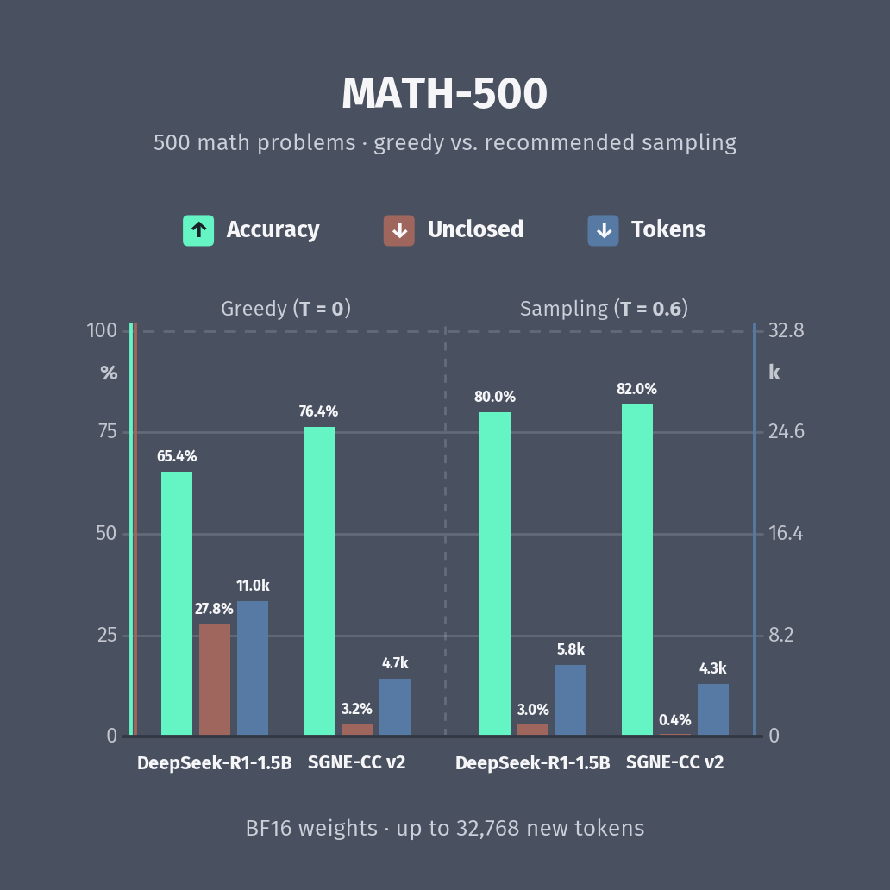
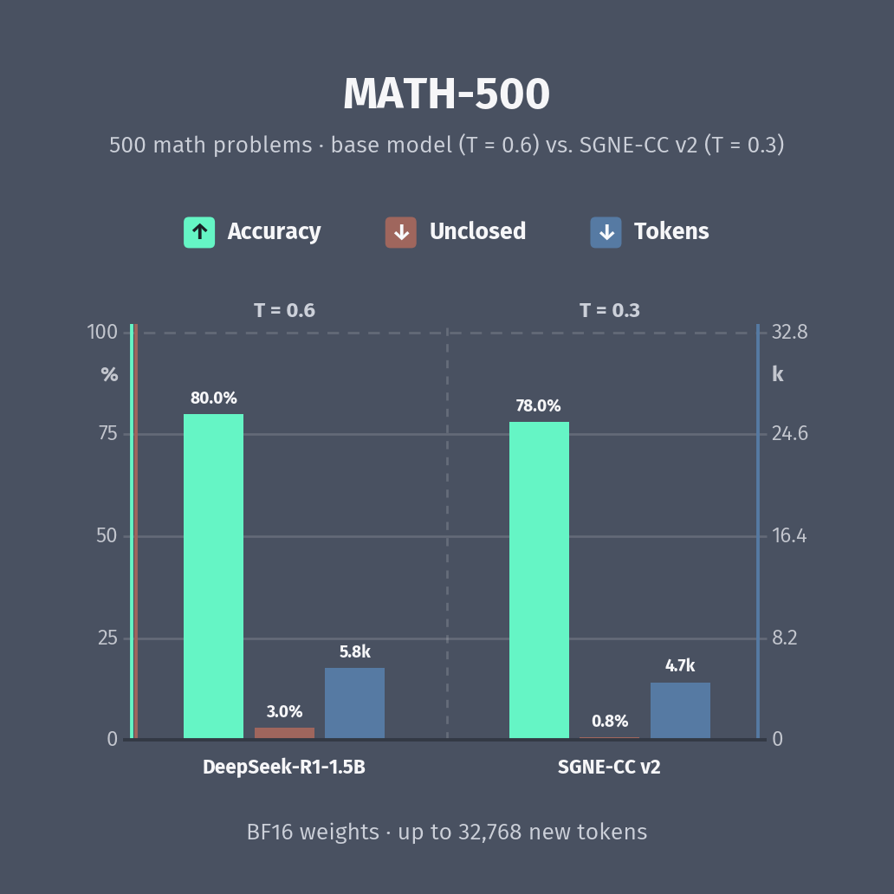
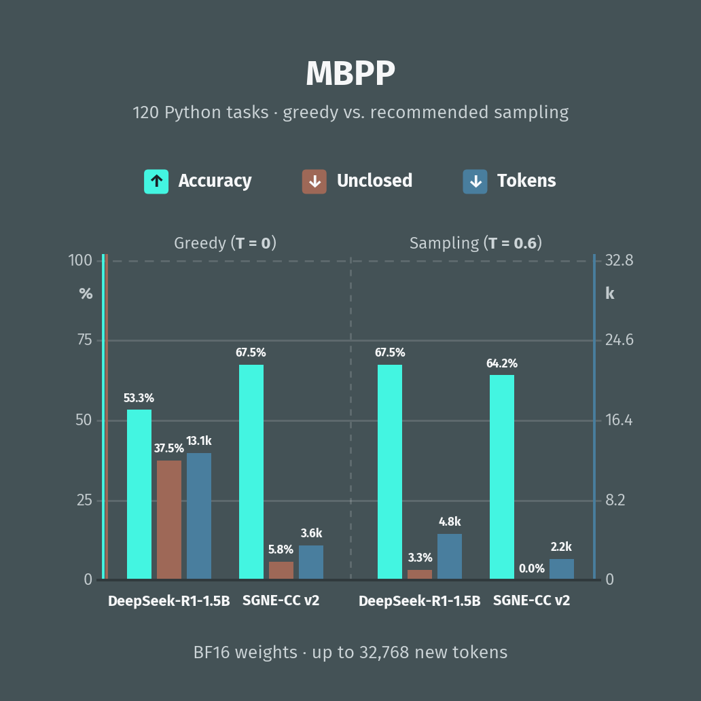
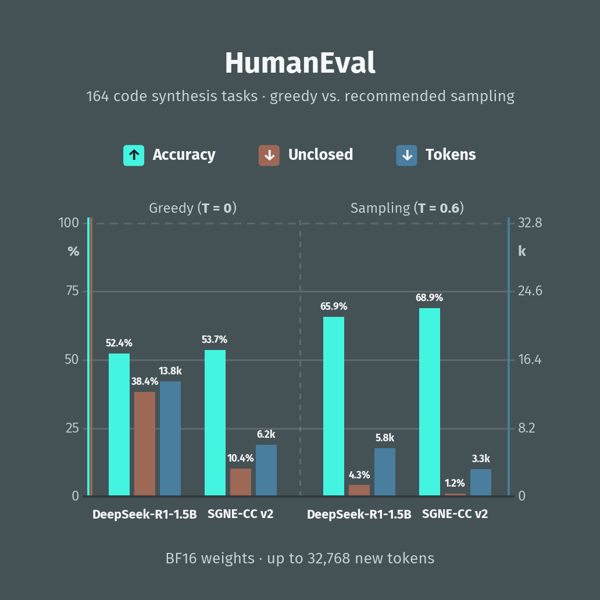
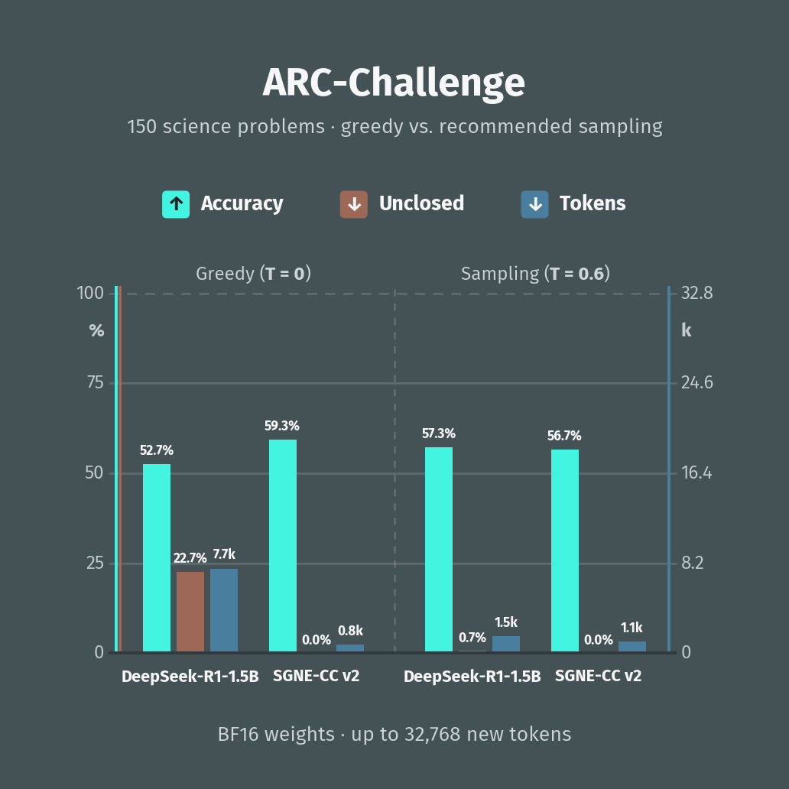
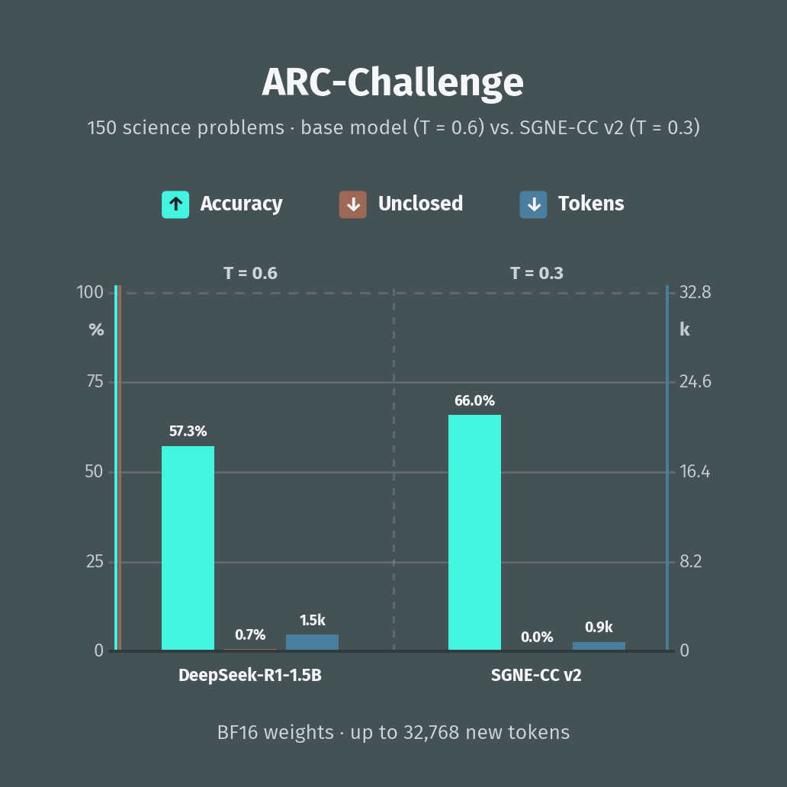
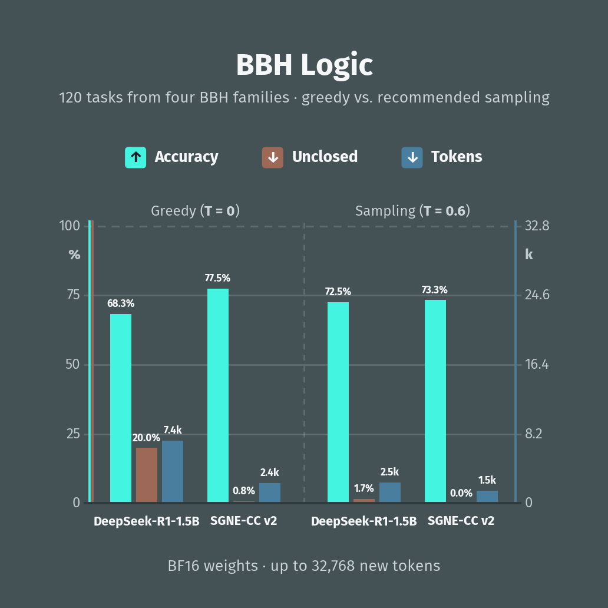

# Editing 205 Weight Columns in `DeepSeek-R1-Distill-Qwen-1.5B` Improves Greedy Accuracy and Reduces Unfinished Responses

**Author:** Igor M. Zhuk · **Repository:** [`Nondual-Observer/deepseek-r1-1.5b-sgne-cc-v2`](https://github.com/Nondual-Observer/deepseek-r1-1.5b-sgne-cc-v2) · **Zenodo (`v2.0.0`):** [DOI: `10.5281/zenodo.24398165`](https://doi.org/10.5281/zenodo.24398165) (Concept DOI [`10.5281/zenodo.24398164`](https://doi.org/10.5281/zenodo.24398164))

Under greedy next-token selection (`T = 0`), the reasoning model `DeepSeek-R1-Distill-Qwen-1.5B` (`1.78B` parameters in `BF16`) frequently stalls in repetitive re-checking of already-found steps inside `<think>...</think>`, exhausting a generation budget of up to `32,768` new tokens. Even under the recommended sampling regime (`T = 0.6, top_p = 0.95`), a noticeable fraction of unfinished responses remains on mathematics and programming benchmarks. **Can the rate of unfinished responses be reduced by a small static weight edit – without fine-tuning, without repetition or presence penalties, and without changing inference code?**

This work transfers **SGNE-CC** (*Spherical Gated Norm-preserving Edit, Column-Constrained*), previously validated on the hybrid `Qwen3.5-0.8B` architecture ([DOI: 10.5281/zenodo.24235218](https://doi.org/10.5281/zenodo.24235218), [`dna-weight-editing`](https://github.com/Nondual-Observer/dna-weight-editing)), to a pure transformer of a different model family (`DeepSeek-R1-Distill-Qwen-1.5B`) as **SGNE-CC v2**, reducing the edit footprint by nearly an order of magnitude – from `1,984` columns (`802 + 1,182`) plus one gate row to **`205` `mlp.down_proj` columns** (**`0.0177%`** of parameters). Base and edited models are compared with a generation budget of **`32,768` new tokens** on five benchmarks (`MATH-500`, `MBPP`, `HumanEval`, `ARC-Challenge`, `BBH Logic`, `1,054` problems total) at two temperatures shared by both models – `T = 0` and `T = 0.6` (the edited model is additionally evaluated at `T = 0.3`).

---

## Contents
1. [Geometry of the Edit: 205 `mlp.down_proj` Columns](#1-geometry-of-the-edit-205-mlpdown_proj-columns)
2. [`MATH-500` after Excluding 26 Calibration Problems and 53 Head-Analysis Items](#2-math-500-after-excluding-26-calibration-problems-and-53-head-analysis-items)
3. [Transfer to Programming (`MBPP` and `HumanEval`)](#3-transfer-to-programming-mbpp-and-humaneval)
4. [Transfer to Scientific Reasoning and Logic (`ARC-Challenge` and `BBH Logic`)](#4-transfer-to-scientific-reasoning-and-logic-arc-challenge-and-bbh-logic)
5. [Cross-Architecture Comparison, Boundaries, Summary, and Reproducibility](#5-cross-architecture-comparison-boundaries-summary-and-reproducibility)

---

## 1. Geometry of the Edit: 205 `mlp.down_proj` Columns

Before applying any modification, we localized where self-copying intensifies inside the model and which matrices can be edited without degrading normal text generation.

**Attention-Head Asymmetry.** Comparing all `336` heads (`28` layers × `12` query heads) across `32` looped and `32` cleanly terminated math traces (`64` `MATH-500` problems) reveals a sharp localization: all `12` heads with the largest surge in attention to self-repetitions (`+29 … +67 pp`) belong to the first key-value group `KV Group 0` (`H0–H5`). In head `L23 H04`, attention to the problem prompt drops from `31%` to `0.3%` (roughly `100×`), while in the top four heads (`L23 H04`, `L19 H03`, `L19 H05`, `L14 H03`) attention to self-repetitions reaches `67–83%`. In preliminary probes, however, composite interventions touching `gate_proj` and output projections reduced next-token agreement on healthy text from `99%` to `78%`; therefore, all attention, normalization, `gate_proj`, and `up_proj` weights are left **completely untouched**.

**Selection of 205 Columns and Norm-Preserving (Spherical) Rotation.** In `SwiGLU`, the contribution of the $j$-th column $w_j = W_{\text{down}}^{(\ell)}[:, j] \in \mathbb{R}^{1536}$ is scaled by $\operatorname{SiLU}(g_j) u_j$, so a column whose gate input $g_j$ is negative on normal text and positive inside repetition effectively acts only during repetition. Using a small calibration set of math traces (`6 + 6` for punctuation selection and `8 + 6` for size tuning; all `26` problems are excluded in §2, and none of the `554` problems from the other four benchmarks were used for column selection), we selected two disjoint groups:
1. **Newline-boundary columns (`135` columns, layers `L18–L27`):** active on newline tokens (including `\n\n`) during repetition, suppressed inside clauses and after `</think>`.
2. **Punctuation columns (`70` columns, layers `L19–L27`):** active on `.`, `?`, `!` inside repeating paragraphs without line breaks (mean gate input `+0.85` vs. `−1.41` on healthy punctuation and `−1.81` after `</think>`).

Each column is rotated toward the unit reasoning-end direction $u_{\text{ET}} = \tilde{u} / \|\tilde{u}\|_2$, where $\tilde{u} = \gamma_{\text{norm}} \odot (W_{\text{lm}}[\text{`</think>`}] - \bar{W}_{\text{lm}})$ and $s_j = \operatorname{sign}(\overline{\operatorname{SiLU}(g_j) u_j})$, with exact restoration of the original Euclidean norm $\|w_j\|_2$ before rounding to `BF16`:
$$w_j' = \operatorname{BF16}\!\left(\|w_j\|_2 \cdot \frac{w_j + \beta s_j \|w_j\|_2 u_{\text{ET}}}{\|w_j + \beta s_j \|w_j\|_2 u_{\text{ET}}\|_2}\right), \qquad \beta = 2.$$

| Weight-Edit Parameter (`BF16`) | Base Model | `SGNE-CC v2` (`205` columns) |
| :--- | :---: | :---: |
| Total parameters (`model.safetensors`) | `1,777,088,000` | `1,777,088,000` |
| Modified `mlp.down_proj` columns (`L18–L27`) | `0` | **`205`** (`135` newline + `70` punctuation) |
| Scalars in edited region / differing in `BF16` | `0` | **`314,880` (`0.01772%`)** / `314,418` |
| Rotation angles / mean norm ratio $\bar{\kappa}_{\text{BF16}}$ | `0°` / `1.000000` | `59.93° – 66.64°` / **`0.99999339`** (`FP64`, max dev `< 0.03%`) |
| Changes to attention, `gate/up_proj`, vocabulary, or code | none | **none** |

---

## 2. `MATH-500` after Excluding 26 Calibration Problems and 53 Head-Analysis Items

We begin with the domain used to select the `205` columns: greedy decoding (`T = 0`) and recommended sampling (`T = 0.6`), then the subsets that exclude the `26` calibration problems and the `53` head-analysis problems, and finally `T = 0.3`.



**Fig. 1. At zero temperature, rotating 205 columns reduces unfinished responses on MATH-500 and closes three-quarters of the gap to stochastic sampling.** *Full MATH-500 (500 problems), vLLM 0.34.0, BF16, generation budget of 32,768 new tokens, `presence_penalty = 0`. Traces without a closing `</think>` marker are scored zero.*

With greedy decoding, responses missing `</think>` fell from `139` to `16`, and responses missing `EOS` also fell from `139` to `16` (in the edited model, `12` responses lack both). Mean output length fell from `11.0k` to `4.7k` tokens. The edit gained `74` correct answers and lost `19` (exact McNemar $p = 7.72 \times 10^{-9}$). At `T = 0.6`, correct answers rose from `400` to `410`, a difference that is not statistically significant (`+33 / −23`, $p = 0.2288$); responses missing `</think>` fell from `15` to `2`, and mean length from `5.8k` to `4.3k` tokens.

**Calibration and Head-Analysis Exclusion Checks.**
- **Excluding the `26` column-selection problems (`474` `MATH-500` problems):** at `T = 0`, accuracy rises from `310` to `363` (`+70 / −17`, $p = 8.35 \times 10^{-9}$); at `T = 0.6`, the comparison is unchanged ($p = 0.1690$).
- **Additionally excluding `53` problems from the §1 head-atlas inspection (`421` problems):** of the `64` problems (`32 + 32`) used to inspect attention heads in §1, `53` overlapped the `474`-item split. On the remaining **`421` problems**, the greedy gain persists (`276 → 321`, `+60 / −15`, $p = 1.59 \times 10^{-7}$), and at `T = 0.6` accuracy is `337 → 346` (`+29 / −20`, $p = 0.253$).



**Fig. 2. Lowering the edited model's temperature to `T = 0.3` preserves near-complete closure but does not beat the base model at `T = 0.6`.** *Comparison of two operating points differing in both weights and temperature (`top_p = 0.95`, `seed = 42`, 500 MATH-500 problems; the base model was not evaluated at `T = 0.3`).*

The edited model left `4` reasoning traces unclosed at `T = 0.3` and `2` at `T = 0.6`. The base model left `15` unclosed at `T = 0.6`. Comparing the edited model at `0.3` with the base model at `0.6` gave `+29 / −39` correct answers ($p = 0.2750$, or $p = 0.3284$ after excluding the 26 calibration problems). Of the two temperatures, the edited model solved more MATH-500 problems at `0.6`.

---

## 3. Transfer to Programming (`MBPP` and `HumanEval`)

Neither coding benchmark was used for column selection. Here we test whether the effect carries over to executable Python and whether the rotation damages syntax. In `MBPP`, the prompt displays the first `3` `assert` checks, while evaluation executes the full `test_list` (`3` checks in `116` tasks, `4` in `#58, #223, #226`, `5` in `#172` – `360` shown vs. `365` executed); in `HumanEval`, solutions run against the hidden `test` suite.



**Fig. 3. On `MBPP` at `T = 0`, the edit brings greedy decoding to `81/120` – the base model's level at `T = 0.6` – with responses `3.7×` shorter than the greedy base (and `1.34×` shorter than the base at `T = 0.6`); at `T = 0.6`, the edited model solves four fewer tasks (not significant).** *120 `MBPP` problems, isolated Python execution of full `test_list`, BF16, 32,768-token budget.*

At `T = 0`, unclosed responses fell from `45` to `7`. On `40` tasks the base model left the reasoning open and the edited model closed it. The edited program passed the tests on `20` of those tasks. Across all `120` tasks the edit gained `21` passes and lost `4` ($p = 9.11 \times 10^{-4}$). Mean length fell from `13.1k` to `3.6k` tokens (`3.7×` shorter, or `1.34×` relative to the base model at `T = 0.6`). At `T = 0.6`, unclosed responses fell from `4` to `0` and mean length fell from `4.8k` to `2.2k` tokens. The base model solved `81` tasks and the edited model solved `77` (`+7 / −11`, $p = 0.4807$). This comparison used one random seed.



**Fig. 4. On `HumanEval`, the edit sharply reduces unclosed traces and output length in both regimes, but at `T = 0` barely increases the number of passed hidden tests.** *164 `HumanEval` problems, hidden unit tests, BF16, 32,768-token budget.*

**A different error pattern at `T = 0`.** Unlike `MBPP`, on `HumanEval` unclosed traces drop `3.7×` (`63 → 17`) and tokens drop `2.2×` (`13.8k → 6.2k`), yet paired pass balance stays nearly symmetric (`+20 / −18`, $p = 0.8714$). Among the `53` tasks where the base model left `<think>` unclosed at `T = 0` and `SGNE-CC v2` closed it, `49` parse syntactically as valid Python, `3` yield no extracted program, and `1` (index `75`) has a syntax error; syntactically valid code does not by itself pass the hidden tests, and the overall balance remains `+20 / −18`. At `T = 0.6`, the edit maintains a positive balance (`+16 / −11`, $p = 0.4421$) with `1.8×` shorter traces (`5.8k → 3.3k`).

---

## 4. Transfer to Scientific Reasoning and Logic (`ARC-Challenge` and `BBH Logic`)

Finally, we test non-math, non-code tasks that were not used for column selection: multiple-choice science questions and multi-step logic problems.





**Fig. 5–6. On `ARC-Challenge`, the edit eliminates unclosed traces in all regimes and cuts greedy output length nearly tenfold; highest accuracy among tested configurations occurs at `T = 0.3`.** *150 `ARC-Challenge` problems, BF16, 32,768-token budget. The grader first checks `\boxed{}` and falls back to recognizing other answer formats (`87` of `89` correct `SGNE-CC v2` answers at `T = 0` and all `85` at `T = 0.6` were graded without a boxed letter).*

On `ARC-Challenge`, all `150` `SGNE-CC v2` responses close `<think>` in each of the three regimes. At `T = 0`, mean length drops `9.8×` with a positive but not statistically significant accuracy shift (`+28 / −18`, $p = 0.1839$); at `T = 0.6`, the base and edited models are practically tied (`+18 / −19`, $p = 1.0000$). **Temperature comparison (`T = 0.3`).** Unlike `MATH-500`, on short science questions `SGNE-CC v2` at `T = 0.3` reaches `99/150` vs. `86/150` for the base model at `T = 0.6` (`+31 / −18`, $p = 0.0854$) at under `1k` tokens per answer (the base model was not evaluated at `T = 0.3`).



**Fig. 7. On `BBH Logic`, greedy decoding with `SGNE-CC v2` reaches `93/120` (vs. `82/120` for the greedy base model and `87/120` for the base model at `T = 0.6`).** *120 problems from four `BBH` task families, BF16, 32,768-token budget.*

On `BBH Logic`, the greedy base model leaves a fifth of its answers unclosed (`24/120`), whereas `SGNE-CC v2` leaves only one, cuts length `3.1×` (`7.4k → 2.4k`), and raises greedy accuracy (`82 → 93`, `+23 / −12`, $p = 0.0895$; against the base model at `T = 0.6`: `87 → 93`, `+22 / −16`, $p = 0.4177$). At `T = 0.6`, accuracy stays level (`+18 / −17`, $p = 1.0000$), no traces are left unclosed, and token use drops by `40%`.

---

## 5. Cross-Architecture Comparison, Boundaries, Summary, and Reproducibility

### 5.1. Cross-Architecture Transfer vs. `Qwen3.5-0.8B` (`v1`)

In our first study ([DOI: 10.5281/zenodo.24235218](https://doi.org/10.5281/zenodo.24235218), [`dna-weight-editing`](https://github.com/Nondual-Observer/dna-weight-editing)), `SGNE-CC` (`v1`) was developed for the hybrid `Qwen3.5-0.8B`, where `75%` of layers are recurrent `GatedDeltaNet` blocks. Comparing both studies shows that spherical column rotation transfers to a pure transformer and needs a much smaller edit (note that the two studies use different presence penalties and math-grading parsers, and architecture vs. model-size effects are not isolated):

| Metric (`BF16`, `32,768`-token budget) | `v1`: `Qwen3.5-0.8B` (`DOI: 10.5281/zenodo.24235218`) | `v2` (This Work): `DeepSeek-R1-Distill-Qwen-1.5B` |
| :--- | :---: | :---: |
| Architecture and parameter count | Hybrid (`18` `GatedDeltaNet` + `6` attention), `752M` | Pure transformer (`28` `GQA` layers), `1.78B` |
| `SGNE-CC` edit footprint | `1,984` columns (`802` `mlp.down_proj` + `1,182` `GatedDeltaNet`) + `1` gate row, `0.270%` weights (`3.13 MiB`) | **`205` `mlp.down_proj` columns** (`135` + `70`), **`0.0177%`** weights (`0.58 MiB`), zero recurrent/gate edits |
| Max column norm deviation in `BF16` | `0.1625%` (`[0.998375, 1.001620]`) | **`< 0.03%`** (`0.0295%`, mean `0.99999339`) |
| `MATH-500` greedy (`T = 0, pp = 0`) | `0.0% → 43.0%`; no `</think>`: `100% → 7.2%` (`500 → 36`); no `EOS`: `100% → 18.4%` (`500 → 92`); length `32.8k → 8.6k` | `65.4% → 76.4%`; no `</think>`: `27.8% → 3.2%` (`139 → 16`); no `EOS`: `27.8% → 3.2%` (`139 → 16`); length `11.0k → 4.7k` |
| `HumanEval-164` greedy (`T = 0`) | **`5.5% → 32.3%`** (`9/164 → 53/164`) | `52.4% → 53.7%` (no `</think>` `38.4% → 10.4%`, length `13.8k → 6.2k`) |
| Sampling (`T = 0.6`)* | `MATH-500` (`pp = 1.5`): `7.8% → 47.0%`; no `</think>`: `92.2% / 0.2%` (`MIT-p50c` `18.2%`); no `EOS`: `92.2% / 1.6%` (`MIT-p50c` `28.2%`); `4.0×` shorter vs. `MIT-p50c` (`21,052.9 → 5,319.4`; base `30,632.6`) | `MATH-500` (`pp = 0`): `80.0% → 82.0%`, no `</think>`: `3.0% → 0.4%`, `−26%` tokens (`−33.6%` across `1,054`) |

*\*The `Qwen3.5-0.8B` model card prescribes `presence_penalty = 1.5`, whereas all `DeepSeek-R1-Distill-Qwen-1.5B` runs use `presence_penalty = 0`.*

The transfer to a pure transformer shows that `SGNE-CC` does not require recurrent `GatedDeltaNet` blocks: the edited parameter fraction drops `15×` (`0.270% → 0.0177%`), and the maximum column-norm deviation in `BF16` shrinks `5.5×` (`0.1625% → 0.0295%`).

### 5.2. Method Boundaries and Observed Costs
- **Lost solutions.** Across all `1,054` problems at `T = 0`, `166` newly solved problems are accompanied by `71` losses. Inspection of those `71` losses shows `18` closed earlier than the base model, `38` closed later, and `15` remained unclosed – a single `</think>` position does not causally explain individual errors.
- **Repeated `</think>` markers.** After the first closure inside the final answer, `SGNE-CC v2` occasionally emits a second `</think>` token (`84` cases at `T = 0`, `83` at `T = 0.6` vs. `0` and `3` in the base model).
- **Overall accuracy under sampling.** At `T = 0.6`, the base model solved `762` of `1,054` problems and the edited model solved `773` (`+92 / −81`, $p = 0.4472$): under sampling, the edit acts primarily as length compression (`−33.6%`) and closure stabilization (`29 → 4`; `EOS` cap hits `30 → 4`).

### 5.3. Conclusion
Spherical rotation of `205` `mlp.down_proj` columns (`0.0177%` of parameters) without gradient training or decoder changes substantially reduces unfinished responses in the pure transformer `DeepSeek-R1-Distill-Qwen-1.5B`. With greedy decoding (`T = 0`), correct answers rose from `638` to `733` out of `1,054` (`+9.0 pp`, $p = 6.07 \times 10^{-10}$), responses without a closing reasoning marker fell from `305` to `41` (`EOS` timeouts: `300 → 38`), and mean output length dropped from `10.8k` to `4.0k` tokens. At a temperature of `0.6`, accuracy was `72.3%` for the base model and `73.3%` for the edited model (paired $p = 0.4472$), while mean output length fell by `33.6%` and responses missing `</think>` dropped from `29` to `4`.

### 5.4. Full Summary Table Across All `1,054` Problems (`BF16`, `32,768`-Token Budget)

Cells show accuracy, a three-way outcome breakdown (**correct / wrong after `</think>` / no `</think>`**), and mean tokens (`k`); `seed = 42` at `T = 0.6`; $p$-values from exact two-sided McNemar test.

| Benchmark (`N`) | Mode | Base Model: Acc (`C / W / No </think>`) · Tok | `SGNE-CC v2`: Acc (`C / W / No </think>`) · Tok | Gained / Lost and $p$ |
| :--- | :--- | :---: | :---: | :--- |
| **MATH-500** (`500`) | Greedy (`T = 0`) | `65.4%` (`327` / `34` / `139`) · `11.0k` | **`76.4%`** (`382` / `102` / **`16`**) · **`4.7k`** | **`+11.0 pp`** (`+74 / −19`, $p = 7.72 \times 10^{-9}$) |
| **MATH-500** (`500`) | Sampling (`T = 0.6`) | `80.0%` (`400` / `85` / `15`) · `5.8k` | **`82.0%`** (`410` / `88` / **`2`**) · **`4.3k`** | `+2.0 pp` (`+33 / −23`, $p = 0.2288$) |
| **MBPP** (`120`) | Greedy (`T = 0`) | `53.3%` (`64` / `11` / `45`) · `13.1k` | **`67.5%`** (`81` / `32` / **`7`**) · **`3.6k`** | **`+14.2 pp`** (`+21 / −4`, $p = 9.11 \times 10^{-4}$) |
| **MBPP** (`120`) | Sampling (`T = 0.6`) | `67.5%` (`81` / `35` / `4`) · `4.8k` | `64.2%` (`77` / `43` / **`0`**) · **`2.2k`** | `-3.3 pp` (`+7 / −11`, $p = 0.4807$) |
| **HumanEval** (`164`) | Greedy (`T = 0`) | `52.4%` (`86` / `15` / `63`) · `13.8k` | **`53.7%`** (`88` / `59` / **`17`**) · **`6.2k`** | `+1.2 pp` (`+20 / −18`, $p = 0.8714$) |
| **HumanEval** (`164`) | Sampling (`T = 0.6`) | `65.9%` (`108` / `49` / `7`) · `5.8k` | **`68.9%`** (`113` / `49` / **`2`**) · **`3.3k`** | `+3.0 pp` (`+16 / −11`, $p = 0.4421$) |
| **ARC-Challenge** (`150`) | Greedy (`T = 0`) | `52.7%` (`79` / `37` / `34`) · `7.7k` | **`59.3%`** (`89` / `61` / **`0`**) · **`0.8k`** | `+6.7 pp` (`+28 / −18`, $p = 0.1839$) |
| **ARC-Challenge** (`150`) | Sampling (`T = 0.6`) | `57.3%` (`86` / `63` / `1`) · `1.5k` | `56.7%` (`85` / `65` / **`0`**) · **`1.1k`** | `-0.7 pp` (`+18 / −19`, $p = 1.0000$) |
| **BBH Logic** (`120`) | Greedy (`T = 0`) | `68.3%` (`82` / `14` / `24`) · `7.4k` | **`77.5%`** (`93` / `26` / **`1`**) · **`2.4k`** | `+9.2 pp` (`+23 / −12`, $p = 0.0895$) |
| **BBH Logic** (`120`) | Sampling (`T = 0.6`) | `72.5%` (`87` / `31` / `2`) · `2.5k` | **`73.3%`** (`88` / `32` / **`0`**) · **`1.5k`** | `+0.8 pp` (`+18 / −17`, $p = 1.0000$) |
| **Pooled (`1,054`)** | **Greedy (`T = 0`)** | `60.5%` (`638` / `111` / `305`) · `10.8k` | **`69.5%`** (`733` / `280` / **`41`**) · **`4.0k`** | **`+9.0 pp`** (`+166 / −71`, **$p = 6.07 \times 10^{-10}$**) |
| **Pooled (`1,054`)** | **Sampling (`T = 0.6`)** | `72.3%` (`762` / `263` / `29`) · `4.7k` | **`73.3%`** (`773` / `277` / **`4`**) · **`3.1k`** | `+1.0 pp` (`+92 / −81`, $p = 0.4472$) |

*(Across the four non-math benchmarks at `T = 0`: `311 → 351` out of `554`, $p = 0.00108$; overall mean length reduction is `63.1%` at `T = 0` and `33.6%` at `T = 0.6`.)*

### 5.5. Generation Protocol, Licensing, and Independent Reproducibility (`SHA-256`)
- **`32,768`-token budget and `316` continuations:** all `25` runs (`5,270` answers) were executed in `BF16` on `vLLM 0.34.0` with `presence_penalty = 0`. Target budget was `32,768` new tokens; for `316` resumed greedy base traces (`T = 0`), the initial text was re-tokenized and given `24,576` continuation tokens (in one case – `BBH Logic`, index `11`, `8,193 + 24,576` – total generated tokens reached `32,769`). Re-tokenizing the saved text matches `total_tokens` exactly in `446` answers, differs by `1` token in `4,771`, and by `2` tokens in `53`; resumed step counters are recorded separately in the certificate.
- **Weights, datasets, and licenses:** see [`DATASETS_AND_LICENSES.md`](../DATASETS_AND_LICENSES.md). Raw `MATH-500` problem texts are omitted from the public repository (replaced by `datasets/math500_ids_manifest.json` and `traces/math500_per_item_results.json` with per-item scores and `text_sha256` digests). Base model `deepseek-ai/DeepSeek-R1-Distill-Qwen-1.5B` (`model.safetensors`, `SHA-256: 58858233513d76b8703e72eed6ce16807b523328188e13329257fb9594462945`), patch [`FINAL_SGNE_CC_V2_205_PATCH.npz`](../patch/FINAL_SGNE_CC_V2_205_PATCH.npz) (`SHA-256: 6f435a63eb306047fe55353b7a911d32a17dd999efa65f082dd1d7c3779a0b2c`), certificate [`SHA256_AND_METRICS_CERTIFICATE.json`](../verification/SHA256_AND_METRICS_CERTIFICATE.json), and manifest [`SHA256_MANIFEST.json`](../verification/SHA256_MANIFEST.json) (`42/42` SHA-256 checksums).
- **Commands from repository root:**
  ```bash
  # Requires: numpy
  python3 verification/verify_repo_integrity.py

  # Requires: numpy, torch, safetensors
  python3 patch/apply_sgne_cc_v2_205_to_safetensors.py \
      --base-dir /path/to/DeepSeek-R1-Distill-Qwen-1.5B \
      --patch    patch/FINAL_SGNE_CC_V2_205_PATCH.npz \
      --out-dir  /path/to/DeepSeek-R1-Distill-Qwen-1.5B-SGNE-CC-v2
  ```
