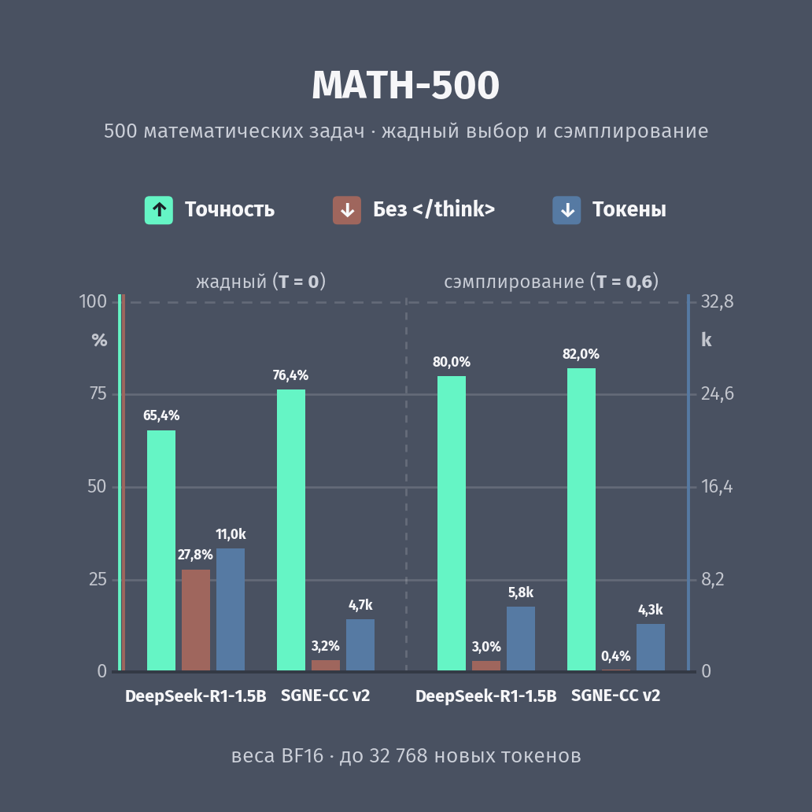
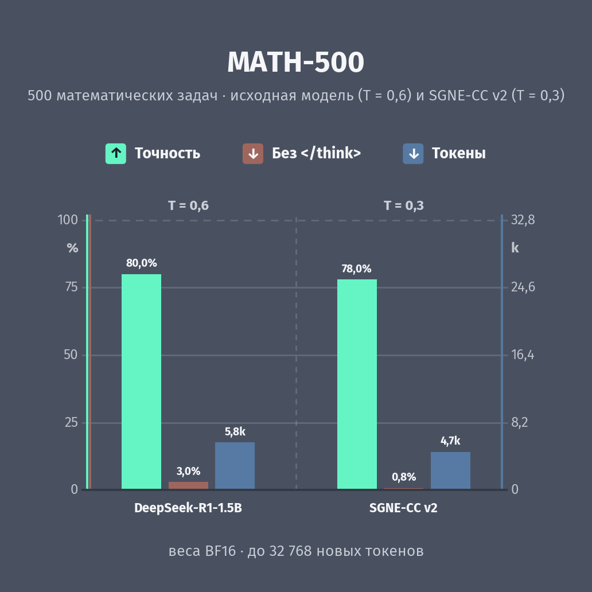
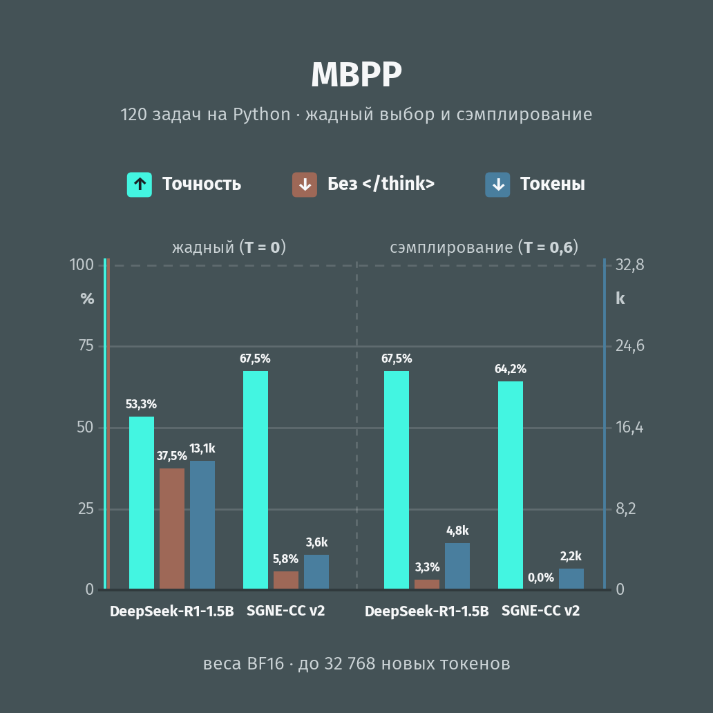
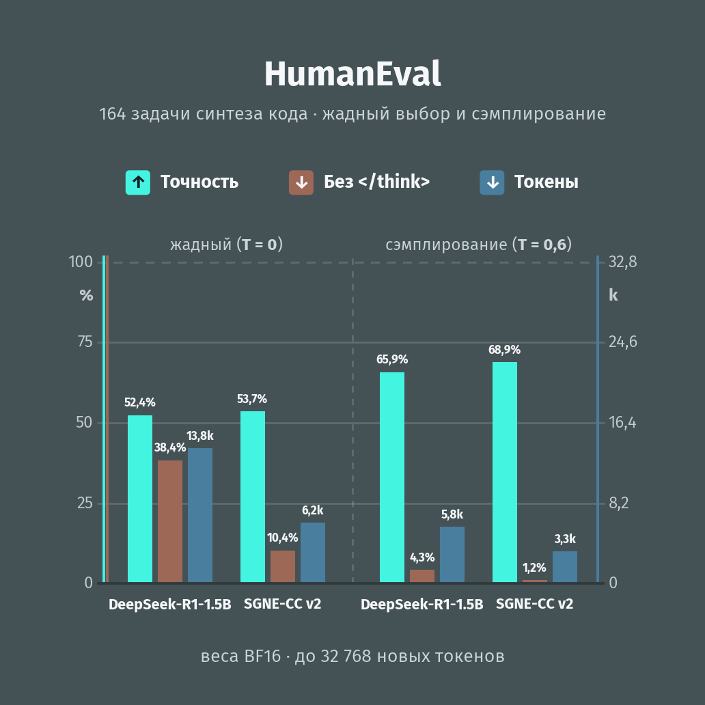
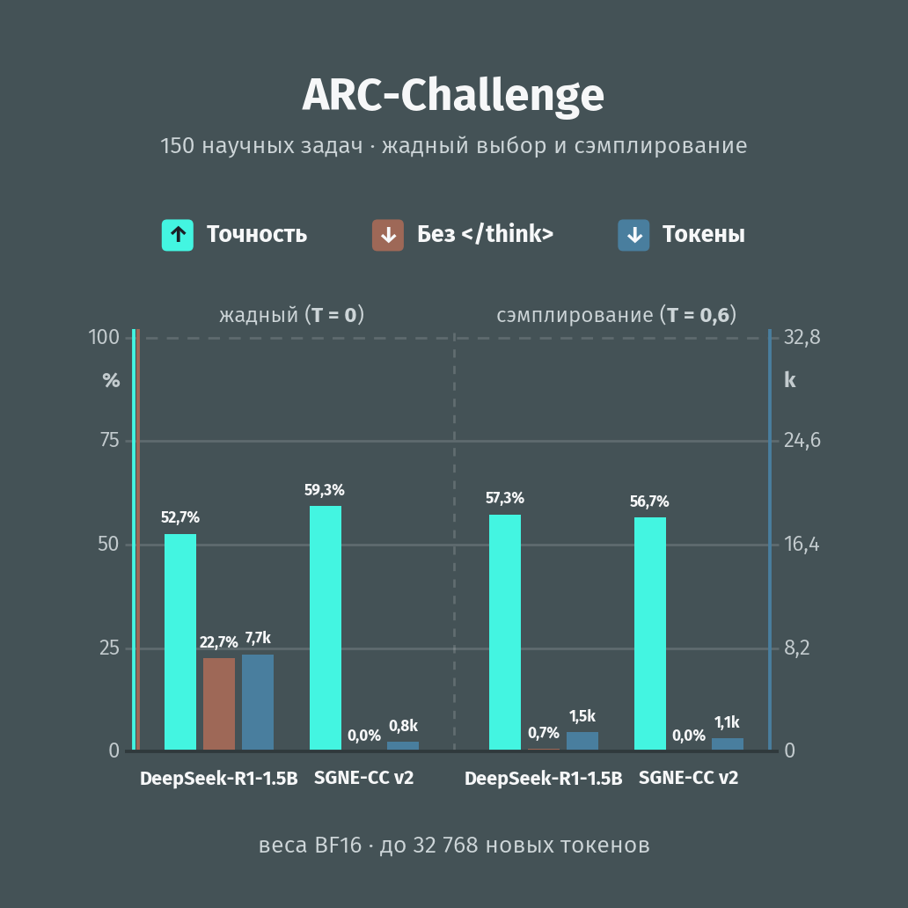
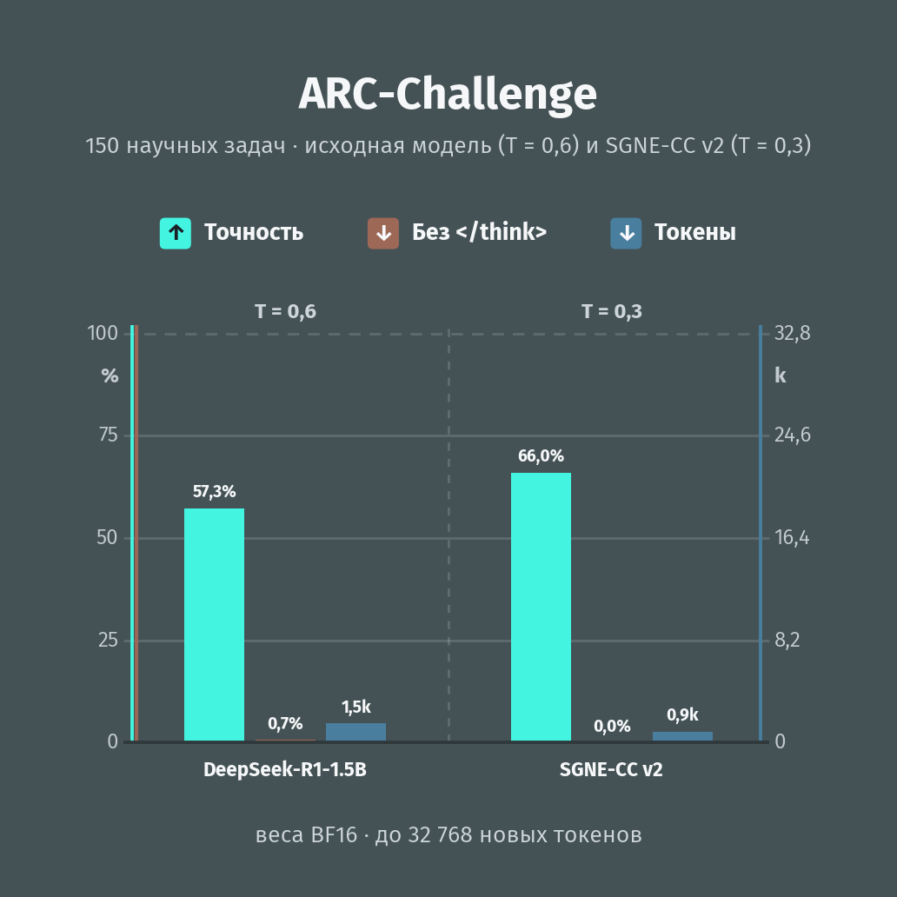
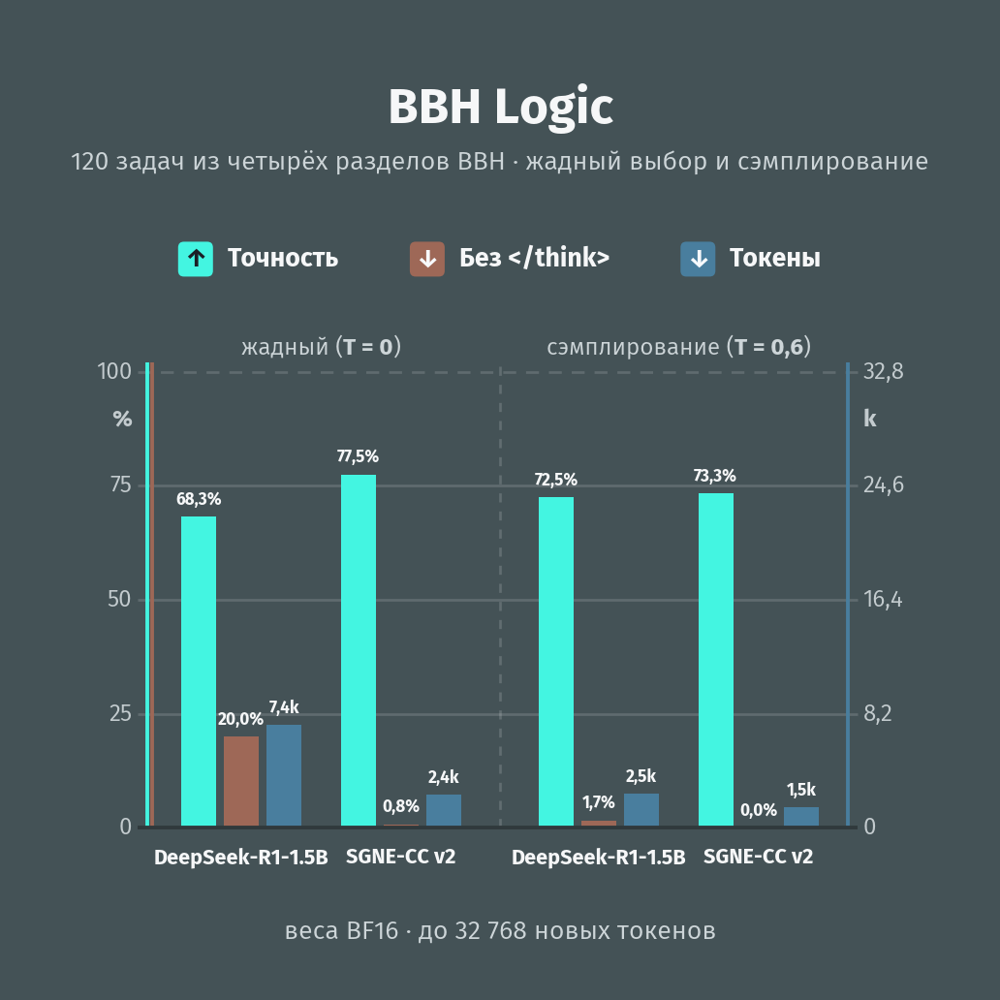

# Сферическая правка 205 столбцов весов `DeepSeek-R1-Distill-Qwen-1.5B`: повышение точности жадного выбора и сокращение незавершённых ответов при бюджете 32 768 токенов

**Автор:** Игорь М. Жук · **Hugging Face (`BF16`):** [`Nondual-Observer/DeepSeek-R1-Distill-Qwen-1.5B-SGNE-CC-v2`](https://huggingface.co/Nondual-Observer/DeepSeek-R1-Distill-Qwen-1.5B-SGNE-CC-v2) · **GitHub:** [`Nondual-Observer/deepseek-r1-1.5b-sgne-cc-v2`](https://github.com/Nondual-Observer/deepseek-r1-1.5b-sgne-cc-v2) · **Zenodo (`v2.0.0`):** [DOI: `10.5281/zenodo.24398165`](https://doi.org/10.5281/zenodo.24398165) (Concept DOI [`10.5281/zenodo.24398164`](https://doi.org/10.5281/zenodo.24398164))

При жадном выборе следующего токена (`T = 0`) рассуждающая модель `DeepSeek-R1-Distill-Qwen-1.5B` (`1.78` млрд параметров в формате `BF16`) часто застревает в повторной перепроверке уже найденных шагов внутри `<think>...</think>`, исчерпывая бюджет вплоть до предела `32 768` токенов. Даже при рекомендованном сэмплировании (`T = 0.6, top_p = 0.95`) в математике и программировании сохраняется заметная доля незавершённых ответов. **Можно ли снизить число незавершённых рассуждений малой статической поправкой к самим весам — без дообучения, без штрафа за повторы и без изменения кода инференса?**

Настоящая работа переносит метод **SGNE-CC** (*Spherical Gated Norm-preserving Edit, Column-Constrained*), ранее проверенный на гибридной `Qwen3.5-0.8B` ([DOI: 10.5281/zenodo.24235218](https://doi.org/10.5281/zenodo.24235218), [`dna-weight-editing`](https://github.com/Nondual-Observer/dna-weight-editing)), на чистый трансформер другого семейства (`DeepSeek-R1-Distill-Qwen-1.5B`) в виде **`SGNE-CC v2`** и сокращает объём правки почти на порядок — с `1 984` столбцов (`802 + 1 182`) и одной строки ворот до **`205` столбцов `mlp.down_proj`** (**`0.0177%`** параметров). Исходная и исправленная модели сравниваются при бюджете до **`32 768` новых токенов** на пяти бенчмарках (`MATH-500`, `MBPP`, `HumanEval`, `ARC-Challenge`, `BBH Logic`, всего `1 054` задачи) при двух общих для обеих моделей температурах — `T = 0` и `T = 0.6` (исправленная модель дополнительно оценена при `T = 0.3`).

---

## Содержание
1. [Геометрия поправки: 205 столбцов `mlp.down_proj`](#1-геометрия-поправки-205-столбцов-mlpdown_proj)
2. [Математика (`MATH-500` после исключения 26 задач отбора и 53 задач анализа голов)](#2-математика-math-500-после-исключения-26-задач-отбора-и-53-задач-анализа-голов)
3. [Перенос на программирование (`MBPP` и `HumanEval`)](#3-перенос-на-программирование-mbpp-и-humaneval)
4. [Перенос на научный вывод и логику (`ARC-Challenge` и `BBH Logic`)](#4-перенос-на-научный-вывод-и-логику-arc-challenge-и-bbh-logic)
5. [Сравнение с предыдущей работой, границы метода, сводка и воспроизводимость](#5-сравнение-с-предыдущей-работой-границы-метода-сводка-и-воспроизводимость)

---

## 1. Геометрия поправки: 205 столбцов `mlp.down_proj`

Прежде чем вносить правку, мы проверили, где именно внутри модели замыкается цикл самокопирования и какие матрицы можно менять без ухудшения обычного текста.

**Асимметрия голов внимания.** Сопоставление всех `336` голов (`28` слоёв × `12` голов) на `32` зацикленных и `32` штатно завершённых математических трассах (`64` задачи `MATH-500`) выявляет резкую локализацию: все `12` голов с наибольшим ростом внимания к собственным повторам (`+29 … +67 п.п.`) лежат в первой группе `KV Group 0` (`H0–H5`). В голове `L23 H04` внимание к условию задачи падает с `31%` до `0.3%` (примерно в `100` раз), а у четырёх ведущих голов (`L23 H04`, `L19 H03`, `L19 H05`, `L14 H03`) доля внимания к повторам достигает `67–83%`. При этом в предварительных пробах составные вмешательства, затрагивавшие входные ворота `gate_proj` и выходную проекцию, снижали совпадение следующего токена на обычном тексте с `99%` до `78%`, поэтому слои внимания, нормировки, `gate_proj` и `up_proj` оставлены **нетронутыми**.

**Отбор 205 столбцов и нормосохраняющий (сферический) поворот.** В блоке `SwiGLU` вклад $j$-го столбца $w_j = W_{\text{down}}^{(\ell)}[:, j] \in \mathbb{R}^{1536}$ умножается на $\operatorname{SiLU}(g_j) u_j$, поэтому столбец, у которого вход вентиля $g_j$ отрицателен в обычном тексте и положителен в повторе, фактически работает только во время повторов. По малому набору математических трасс (`6 + 6` при отборе пунктуационной группы и `8 + 6` при подборе размера; все `26` задач отдельно исключены в §2, а `554` задачи остальных четырёх бенчмарков в отборе не участвовали) отобраны две непересекающиеся группы:
1. **Границы строк (`135` столбцов, слои `L18–L27`):** активны на токенах с переводом строки (включая `\n\n`) в повторе и подавлены внутри фраз и после `</think>`.
2. **Знаки препинания (`70` столбцов, слои `L19–L27`):** активны на `.`, `?`, `!` внутри повторяющихся абзацев без переносов (средний вход вентиля `+0.85` против `−1.41` на обычной пунктуации и `−1.81` после `</think>`).

Каждый столбец поворачивается к единичному вектору закрытия рассуждения $u_{\text{ET}} = \tilde{u} / \|\tilde{u}\|_2$, где $\tilde{u} = \gamma_{\text{norm}} \odot (W_{\text{lm}}[\text{`</think>`}] - \bar{W}_{\text{lm}})$ и $s_j = \operatorname{sign}(\overline{\operatorname{SiLU}(g_j) u_j})$, с точным восстановлением исходной нормы $\|w_j\|_2$ перед округлением в `BF16`:
$$w_j' = \operatorname{BF16}\!\left(\|w_j\|_2 \cdot \frac{w_j + \beta s_j \|w_j\|_2 u_{\text{ET}}}{\|w_j + \beta s_j \|w_j\|_2 u_{\text{ET}}\|_2}\right), \qquad \beta = 2.$$

| Параметр весовой поправки (`BF16`) | Исходная модель | `SGNE-CC v2` (`205` столбцов) |
| :--- | :---: | :---: |
| Всего параметров (`model.safetensors`) | `1 777 088 000` | `1 777 088 000` |
| Изменённых столбцов `mlp.down_proj` (`L18–L27`) | `0` | **`205`** (`135` переводы строки + `70` пунктуация) |
| Скаляров в области правки / изменившихся в `BF16` | `0` | **`314 880` (`0.01772%`)** / `314 418` |
| Углы поворота / среднее отношение норм $\bar{\kappa}_{\text{BF16}}$ | `0°` / `1.000000` | `59.93° – 66.64°` / **`0.99999339`** (`FP64`, откл. `< 0.03%`) |
| Изменения внимания, `gate/up_proj`, словаря и кода | нет | **нет** |

---

## 2. Математика (`MATH-500` после исключения 26 задач отбора и 53 задач анализа голов)

Начинаем с области, в которой отбирались `205` столбцов: сначала проверяем, снижает ли поправка число незавершённых ответов при жадном выборе (`T = 0`) и при рекомендованном сэмплировании (`T = 0.6`), затем проверяем срез после исключения калибровочных и исследовательских задач и оцениваем температуру `T = 0.3`.



**Рис. 1. При нулевой температуре поворот 205 столбцов снижает число незавершённых рассуждений на MATH-500 и перекрывает три четверти разрыва до стохастического сэмплирования.** *Полный набор MATH-500 (500 задач), vLLM 0.34.0, BF16, бюджет до 32 768 новых токенов, `presence_penalty = 0`. Ответам без закрывающего маркера `</think>` присваивается ноль.*

При жадном выборе число ответов без `</think>` сократилось со `139` до `16`, без `EOS` — также со `139` до `16` (у исправленной модели оба маркера одновременно отсутствуют в `12` ответах). Средняя длина сократилась с `11.0` до `4.7` тыс. токенов. Исправленная модель решила `74` задачи, на которых исходная ошибалась, и потеряла `19` прежних решений (точный критерий Мак-Немара, $p = 7.72 \times 10^{-9}$). При `T = 0.6` число верных ответов выросло с `400` до `410`, но это различие статистически незначимо (`+33 / −23`, $p = 0.2288$); число ответов без `</think>` снизилось с `15` до `2`, средняя длина — с `5.8` до `4.3` тыс. токенов.

**Проверка исключения калибровочных и исследовательских задач.**
- **Без `26` задач подбора столбцов (`474` задачи `MATH-500`):** при `T = 0` точность растёт с `310` до `363` (`+70 / −17`, $p = 8.35 \times 10^{-9}$); при `T = 0.6` соотношение сохраняется ($p = 0.1690$).
- **Дополнительное исключение `53` задач из анализа голов внимания (`421` задача):** из `64` задач раннего исследования голов (`32 + 32` в §1) `53` входили в те `474` задачи. На оставшихся **`421` задаче** результат сохраняется: при `T = 0` точность растёт с `276` до `321` (`+60 / −15`, $p = 1.59 \times 10^{-7}$), при `T = 0.6` — с `337` до `346` (`+29 / −20`, $p = 0.253$).



**Рис. 2. Понижение температуры исправленной модели до `T = 0.3` удерживает почти полное закрытие рассуждений, но не даёт преимущества по точности над исходной моделью при `T = 0.6`.** *Сопоставление двух режимов, различающихся одновременно весами и температурой (`top_p = 0.95`, `seed = 42`, 500 задач MATH-500; исходная модель при `T = 0.3` не измерялась).*

У исправленной модели незакрытыми остались `4` рассуждения при `T = 0.3` и `2` при `T = 0.6`; у исходной модели при `T = 0.6` их было `15`. В паре «исправленная при `0.3` — исходная при `0.6`» баланс верных решений составил `+29 / −39` ($p = 0.2750$; после исключения `26` задач подбора $p = 0.3284$). Из двух температур исправленная модель решила больше задач `MATH-500` при `0.6`.

---

## 3. Перенос на программирование (`MBPP` и `HumanEval`)

Оба кодовых набора в отборе `205` столбцов не участвовали. Здесь проверяется, сохраняется ли эффект при генерации исполняемого кода Python и не портит ли поворот столбцов синтаксис. В `MBPP` в тексте задачи показаны первые `3` проверки (`assert`), а оценщик исполняет весь `test_list` (`3` проверки в `116` задачах, `4` в № `58, 223, 226`, `5` в № `172` — показано `360`, исполнено `365`); в `HumanEval` решение проверяется на скрытом наборе модульных тестов `test`.



**Рис. 3. На `MBPP` при `T = 0` правка поднимает жадный режим до `81/120` — уровня исходной модели при `T = 0.6` — при ответах в `3.7` раза короче, чем у исходной модели при `T = 0` (и в `1.34` раза короче, чем у неё же при `T = 0.6`); при `T = 0.6` исправленная модель решает на четыре задачи меньше (различие незначимо).** *120 задач `MBPP`, исполнение в изолированной среде Python всего `test_list`, BF16, бюджет до 32 768 токенов.*

При `T = 0` число незакрытых ответов сократилось с `45` до `7`. На `40` задачах исходная модель оставила рассуждение открытым, а исправленная его завершила. В `20` из этих случаев программа прошла проверки. По всем `120` задачам поправка дала `21` новое решение и `4` потери ($p = 9.11 \times 10^{-4}$). Средняя длина снизилась с `13.1` до `3.6` тыс. токенов (в `3.7` раза), а относительно исходной модели при `T = 0.6` — в `1.34` раза. При `T = 0.6` число незакрытых ответов снизилось с `4` до `0`, средняя длина — с `4.8` до `2.2` тыс. токенов. Исходная модель решила `81` задачу, исправленная — `77` (`+7 / −11`, $p = 0.4807$). Сравнение проведено при одном начальном значении генератора случайных чисел.



**Рис. 4. На `HumanEval` поправка кратно снижает число незакрытых рассуждений и длину ответа в обоих режимах, но при `T = 0` почти не увеличивает число пройденных скрытых тестов.** *164 задачи `HumanEval`, проверка на скрытых модульных тестах `test`, BF16, бюджет до 32 768 токенов.*

**Другой характер ошибок при `T = 0`.** В отличие от `MBPP`, на `HumanEval` число незакрытых ответов падает в `3.7` раза (`63 → 17`), а расход токенов — в `2.2` раза (`13.8k → 6.2k`), но парный баланс по тестам остаётся почти симметричным (`+20 / −18`, $p = 0.8714$). Из `53` задач, где исходная модель оставляла ответ без `</think>`, а `SGNE-CC v2` его закрыла, в `49` случаях извлечённый код синтаксически разбирается, в `3` случаях программа не извлечена и в `1` (индекс `75`) допущена синтаксическая ошибка; синтаксически корректный код сам по себе не означает прохождения скрытых тестов, и общий баланс остаётся `+20 / −18`. При `T = 0.6` поправка удерживает положительный баланс (`+16 / −11`, $p = 0.4421$) при сокращении длины в `1.8` раза (`5.8k → 3.3k`).

---

## 4. Перенос на научный вывод и логику (`ARC-Challenge` и `BBH Logic`)

Наконец, проверяем задачи без числовых выкладок и без кода, не участвовавшие в отборе столбцов: научные вопросы с выбором ответа и многошаговые логические задачи.





**Рис. 5–6. На `ARC-Challenge` поправка полностью устраняет незакрытые рассуждения во всех режимах и почти в десять раз сокращает жадный вывод; наибольшая точность среди протестированных конфигураций достигается при `T = 0.3`.** *150 задач `ARC-Challenge`, BF16, бюджет до 32 768 токенов. Оценщик сначала ищет букву в рамке `\boxed{}`, а затем распознаёт другие формы записи (`87` из `89` верных ответов `SGNE-CC v2` при `T = 0` и все `85` при `T = 0.6` зачтены без распознанной буквы в рамке).*

На `ARC-Challenge` все `150` ответов `SGNE-CC v2` закрывают блок `<think>` в каждом из трёх режимов. При `T = 0` это сокращает среднюю длину в `9.8` раза при положительном, но статистически незначимом сдвиге (`+28 / −18`, $p = 0.1839$); при `T = 0.6` точность исходной и исправленной моделей практически совпадает (`+18 / −19`, $p = 1.0000$). **Сравнение температур (`T = 0.3`).** В отличие от `MATH-500`, на коротких научных вопросах при `T = 0.3` `SGNE-CC v2` набирает `99/150` против `86/150` у исходной модели при `T = 0.6` (`+31 / −18`, $p = 0.0854$) при средней длине менее тысячи токенов (исходная модель при `T = 0.3` не измерялась).



**Рис. 7. На `BBH Logic` жадный вывод с поправкой `SGNE-CC v2` повышает долю верных ответов до уровня `93/120` (против `82/120` у исходной модели в жадном режиме и `87/120` у неё же при `T = 0.6`).** *120 задач из четырёх разделов `BBH`, BF16, бюджет до 32 768 токенов.*

На `BBH Logic` исходная модель в жадном режиме оставляет без `</think>` пятую часть ответов (`24/120`), тогда как `SGNE-CC v2` — лишь один, сокращает длину в `3.1` раза (`7.4k → 2.4k`) и даёт в жадной паре `82 → 93` (`+23 / −12`, $p = 0.0895$); относительно исходной модели при `T = 0.6` это `87 → 93` (`+22 / −16`, $p = 0.4177$). При `T = 0.6` точность остаётся на прежнем уровне (`+18 / −17`, $p = 1.0000$), незакрытых рассуждений нет, а расход токенов снижается на `40%`.

---

## 5. Сравнение с предыдущей работой, границы метода, сводка и воспроизводимость

### 5.1. Перенос между архитектурами: сравнение с предыдущей работой на `Qwen3.5-0.8B`

В нашей первой работе ([DOI: 10.5281/zenodo.24235218](https://doi.org/10.5281/zenodo.24235218), [`dna-weight-editing`](https://github.com/Nondual-Observer/dna-weight-editing)) метод `SGNE-CC` (`v1`) был разработан для гибридной модели `Qwen3.5-0.8B`, где `75%` слоёв составляют рекуррентные блоки `GatedDeltaNet`. Сопоставление двух работ показывает, что сферический поворот выходных столбцов переносится на чистый трансформер и требует кратно меньшей правки (при этом у двух работ разные режимы штрафа за повторы и правила оценки математического ответа, а влияние одного лишь размера модели из этого сравнения архитектур не выделено):

| Характеристика (`BF16`, бюджет `32 768` токенов) | `v1`: `Qwen3.5-0.8B` (`DOI: 10.5281/zenodo.24235218`) | `v2` (Настоящая работа): `DeepSeek-R1-Distill-Qwen-1.5B` |
| :--- | :---: | :---: |
| Тип архитектуры и размер | Гибрид (`18` `GatedDeltaNet` + `6` внимания), `752` млн парам. | Чистый трансформер (`28` слоёв `GQA`), `1.78` млрд парам. |
| Объём поправки `SGNE-CC` | `1 984` столбца (`802` `mlp.down_proj` + `1 182` `GatedDeltaNet`) и `1` строка ворот, `0.270%` весов (`3.13` МиБ) | **`205` столбцов `mlp.down_proj`** (`135` + `70`), **`0.0177%`** весов (`0.58` МиБ), без рекуррентных слоёв и ворот |
| Макс. отклонение нормы столбца в `BF16` | `0.1625%` (`[0.998375, 1.001620]`) | **`< 0.03%`** (`0.0295%`, среднее `0.99999339`) |
| `MATH-500` при жадном выводе (`T = 0, pp = 0`) | `0.0% → 43.0%`; без `</think>`: `100% → 7.2%` (`500 → 36`); без `EOS`: `100% → 18.4%` (`500 → 92`); длина `32.8k → 8.6k` | `65.4% → 76.4%`; без `</think>`: `27.8% → 3.2%` (`139 → 16`); без `EOS`: `27.8% → 3.2%` (`139 → 16`); длина `11.0k → 4.7k` |
| `HumanEval-164` при `T = 0` | **`5.5% → 32.3%`** (`9/164 → 53/164`) | `52.4% → 53.7%` (без `</think>` `38.4% → 10.4%`, длина `13.8k → 6.2k`) |
| Сэмплирование (`T = 0.6`)* | `MATH-500` (`pp = 1.5`): `7.8% → 47.0%`; без `</think>`: `92.2% / 0.2%` (`MIT-p50c` `18.2%`); без `EOS`: `92.2% / 1.6%` (`MIT-p50c` `28.2%`); короче в `4.0×` против `MIT-p50c` (`21 052.9 → 5 319.4`; база `30 632.6`) | `MATH-500` (`pp = 0`): `80.0% → 82.0%`, без `</think>`: `3.0% → 0.4%`, короче на `26%` (по всем `1 054` задачам `−33.6%`) |

*\*В карточке `Qwen3.5-0.8B` штатный режим сэмплирования включает `presence_penalty = 1.5`, тогда как для `DeepSeek-R1-Distill-Qwen-1.5B` все прогоны выполнены без штрафа (`presence_penalty = 0`).*

Перенос на чистый трансформер показывает, что метод `SGNE-CC` не требует рекуррентных блоков `GatedDeltaNet`: доля изменённых параметров сократилась в `15` раз (с `0.270%` до `0.0177%`), а максимальное отклонение нормы столбца в `BF16` уменьшилось в `5.5` раза (с `0.1625%` до `0.0295%`).

### 5.2. Границы метода и наблюдаемые издержки
- **Потерянные решения.** В сводной выборке из `1 054` задач при `T = 0` на `166` новых верных решений приходится `71` потерянный ранее верный ответ. Поштучный разбор этих `71` потерь показывает, что в `18` случаях исправленная модель закрыла рассуждение раньше исходной, в `38` — позже, а в `15` оставила его открытым; одной позиции маркера `</think>` недостаточно для причинного объяснения отдельной ошибки.
- **Повторные маркеры `</think>`.** После первого закрытия в тексте окончательного ответа `SGNE-CC v2` иногда порождает повторный служебный маркер `</think>`: `84` случая при `T = 0` и `83` при `T = 0.6` против `0` при `T = 0` и `3` при `T = 0.6` (`BBH` индексы `16` и `22`, `MBPP` индекс `55`) у исходной модели.
- **Общая точность при случайном выборе токенов.** При `T = 0.6` разница в точности по `1 054` задачам статистически незначима (`+92 / −81`, $p = 0.4472$): при сэмплировании поправка проявляется прежде всего как сокращение длины (`−33.6%`) и снятие остаточных незакрытых ответов (`29 → 4`; выходы на потолок по `EOS` — `30 → 4`).

### 5.3. Заключение
Сферический поворот `205` выходных столбцов `mlp.down_proj` (`0.0177%` параметров) без градиентного обучения и без изменения кода декодера существенно сокращает число незавершённых рассуждений в чистом трансформере `DeepSeek-R1-Distill-Qwen-1.5B`. При жадном выборе (`T = 0`) число верных ответов выросло с `638` до `733` из `1 054` (`+9.0 п.п.`, $p = 6.07 \times 10^{-10}$), а число ответов без `</think>` снизилось с `305` до `41` (без `EOS`: `300 → 38`) при сокращении средней длины с `10.8k` до `4.0k` токенов. При `T = 0.6` общая точность составила `72.3%` у базы и `73.3%` у `SGNE-CC v2` (`p = 0.4472`), при снижении средней длины на `33.6%` и сокращении ответов без `</think>` с `29` до `4`.

### 5.4. Сводная таблица по всем `1 054` задачам (`BF16`, бюджет до `32 768` токенов)

В ячейках указаны точность, разбивка на три исхода (**верно / ошибка после `</think>` / без `</think>`**) и средняя длина в тысячах токенов; `seed = 42` при `T = 0.6`, вероятности $p$ вычислены точным двусторонним тестом Мак-Немара.

| Набор (`N`) | Режим | Исходная модель: Точн. (`Верно / Ош. / Без </think>`) · Ток. | `SGNE-CC v2`: Точн. (`Верно / Ош. / Без </think>`) · Ток. | Приобретено / потеряно и $p$ |
| :--- | :--- | :---: | :---: | :--- |
| **MATH-500** (`500`) | Жадный (`T = 0`) | `65.4%` (`327` / `34` / `139`) · `11.0k` | **`76.4%`** (`382` / `102` / **`16`**) · **`4.7k`** | **`+11.0 п.п.`** (`+74 / −19`, $p = 7.72 \times 10^{-9}$) |
| **MATH-500** (`500`) | Сэмплирование (`T = 0.6`) | `80.0%` (`400` / `85` / `15`) · `5.8k` | **`82.0%`** (`410` / `88` / **`2`**) · **`4.3k`** | `+2.0 п.п.` (`+33 / −23`, $p = 0.2288$) |
| **MBPP** (`120`) | Жадный (`T = 0`) | `53.3%` (`64` / `11` / `45`) · `13.1k` | **`67.5%`** (`81` / `32` / **`7`**) · **`3.6k`** | **`+14.2 п.п.`** (`+21 / −4`, $p = 9.11 \times 10^{-4}$) |
| **MBPP** (`120`) | Сэмплирование (`T = 0.6`) | `67.5%` (`81` / `35` / `4`) · `4.8k` | `64.2%` (`77` / `43` / **`0`**) · **`2.2k`** | `-3.3 п.п.` (`+7 / −11`, $p = 0.4807$) |
| **HumanEval** (`164`) | Жадный (`T = 0`) | `52.4%` (`86` / `15` / `63`) · `13.8k` | **`53.7%`** (`88` / `59` / **`17`**) · **`6.2k`** | `+1.2 п.п.` (`+20 / −18`, $p = 0.8714$) |
| **HumanEval** (`164`) | Сэмплирование (`T = 0.6`) | `65.9%` (`108` / `49` / `7`) · `5.8k` | **`68.9%`** (`113` / `49` / **`2`**) · **`3.3k`** | `+3.0 п.п.` (`+16 / −11`, $p = 0.4421$) |
| **ARC-Challenge** (`150`) | Жадный (`T = 0`) | `52.7%` (`79` / `37` / `34`) · `7.7k` | **`59.3%`** (`89` / `61` / **`0`**) · **`0.8k`** | `+6.7 п.п.` (`+28 / −18`, $p = 0.1839$) |
| **ARC-Challenge** (`150`) | Сэмплирование (`T = 0.6`) | `57.3%` (`86` / `63` / `1`) · `1.5k` | `56.7%` (`85` / `65` / **`0`**) · **`1.1k`** | `-0.7 п.п.` (`+18 / −19`, $p = 1.0000$) |
| **BBH Logic** (`120`) | Жадный (`T = 0`) | `68.3%` (`82` / `14` / `24`) · `7.4k` | **`77.5%`** (`93` / `26` / **`1`**) · **`2.4k`** | `+9.2 п.п.` (`+23 / −12`, $p = 0.0895$) |
| **BBH Logic** (`120`) | Сэмплирование (`T = 0.6`) | `72.5%` (`87` / `31` / `2`) · `2.5k` | **`73.3%`** (`88` / `32` / **`0`**) · **`1.5k`** | `+0.8 п.п.` (`+18 / −17`, $p = 1.0000$) |
| **Все (`1 054`)** | **Жадный (`T = 0`)** | `60.5%` (`638` / `111` / `305`) · `10.8k` | **`69.5%`** (`733` / `280` / **`41`**) · **`4.0k`** | **`+9.0 п.п.`** (`+166 / −71`, **$p = 6.07 \times 10^{-10}$**) |
| **Все (`1 054`)** | **Сэмплирование (`T = 0.6`)** | `72.3%` (`762` / `263` / `29`) · `4.7k` | **`73.3%`** (`773` / `277` / **`4`**) · **`3.1k`** | `+1.0 п.п.` (`+92 / −81`, $p = 0.4472$) |

*(Суммарно по четырём нематематическим наборам при `T = 0`: `311 → 351` из `554`, $p = 0.00108$; сокращение средней длины по всей выборке — `63.1%` при `T = 0` и `33.6%` при `T = 0.6`.)*

### 5.5. Протокол генерации, лицензии и независимая воспроизводимость (`SHA-256`)
- **Бюджет `32 768` токенов и `316` продолжений:** все `25` прогонов (`5 270` ответов) исполнены в `BF16` на `vLLM 0.34.0` при `presence_penalty = 0`. Целевой бюджет составлял `32 768` новых токенов; для `316` возобновлённых жадных ответов исходной модели (`T = 0`) исходный текст повторно токенизировали и выделяли `24 576` токенов продолжения (в одном случае — `BBH Logic`, индекс `11`, `8 193 + 24 576` — сумма при исполнении составила `32 769`). Поле `total_tokens` сверено повторной токенизацией всего сохранённого текста (`446` точных совпадений, `4 771` с разницей `1` токен, `53` с разницей `2` токена; счётчики шагов возобновлённой генерации сохранены отдельно в сертификате).
- **Веса, наборы данных и лицензии:** см. [`DATASETS_AND_LICENSES.md`](../DATASETS_AND_LICENSES.md). Исходные тексты условий `MATH-500` в публичном репозитории не перераспространяются (вместо них приложены `datasets/math500_ids_manifest.json` и `traces/math500_per_item_results.json` с построчными оценками и `text_sha256`). Базовая модель `deepseek-ai/DeepSeek-R1-Distill-Qwen-1.5B` (`model.safetensors`, `SHA-256: 58858233513d76b8703e72eed6ce16807b523328188e13329257fb9594462945`), поправка [`FINAL_SGNE_CC_V2_205_PATCH.npz`](../patch/FINAL_SGNE_CC_V2_205_PATCH.npz) (`SHA-256: 6f435a63eb306047fe55353b7a911d32a17dd999efa65f082dd1d7c3779a0b2c`), сертификат [`SHA256_AND_METRICS_CERTIFICATE.json`](../verification/SHA256_AND_METRICS_CERTIFICATE.json) и манифест [`SHA256_MANIFEST.json`](../verification/SHA256_MANIFEST.json) (`42/42` совпадающих `SHA-256`).
- **Команды проверки целостности и наложения поправки из корня репозитория:**
  ```bash
  # Требует: numpy
  python3 verification/verify_repo_integrity.py

  # Требует: numpy, torch, safetensors
  python3 patch/apply_sgne_cc_v2_205_to_safetensors.py \
      --base-dir /path/to/DeepSeek-R1-Distill-Qwen-1.5B \
      --patch    patch/FINAL_SGNE_CC_V2_205_PATCH.npz \
      --out-dir  /path/to/DeepSeek-R1-Distill-Qwen-1.5B-SGNE-CC-v2
  ```
